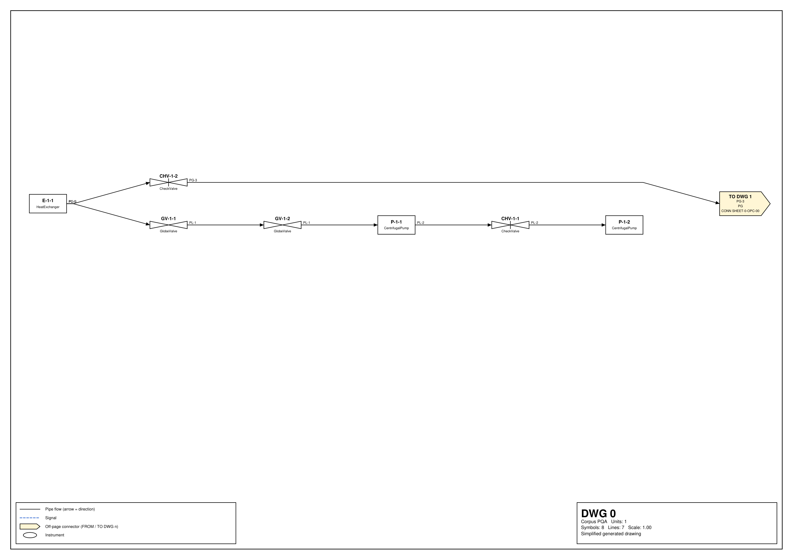

# Adatok és feladat

Ebben a fejezetben bemutatjuk a mérés tárgyát: a három példaüzem rajzát, a tagelt elemeikhez
tartozó gyártói adatlapokat és az üzemenként 60 kérdésből álló kérdéssort. A kis üzemen
fejlesztettük a módszereket, a két nagy üzemen változtatás nélkül mértük meg őket. Minden számot a mellette megadott mérés
(EXP-azonosító) rögzít; a mérések listája a `docs/eredmenyek.md` fájlban található.

## A kis példaüzem

Egy közepesen bonyolult, többlapos P&ID-t generáltunk Kiszely Benedek seedelt generátorával
(plantgraph, v1). A generátor pyDEXPI-modellt épít, a lapokra bontó a vágott vezetékekből
lapok közötti csatlakozópárokat (off-page connector) képez, és maga a bontás a megoldókulcs. A
generátort nem módosítottuk. Két eszközzel szűkítettünk: a berendezéssúlyok csak olyan
osztályokat engednek, amelyekhez van adatlap (centrifugálszivattyú, hőcserélő), a
szabályozókörök változóját (áramlás, szint, nyomás, hőmérséklet) pedig seedkereséssel
szűrtük. Az 1-es seedtől indulva az első olyan seedet fogadtuk el, amelynek üzemében csak
áramlás- és nyomásszabályozó kör van (a nyomástávadó adatlapja mindkettőt lefedi), a tagelt
elemek száma 20 és 40 közé, a lapoké 2 és 4 közé esik, és minden adatlaptípus szerepel. Ez a
6-os seed lett: 26 tagelt elem, 4 lap, 4 lapközi csatlakozópár, 36 csúcs és 116 kapcsolat a
Neo4j-ben tárolt üzemi rétegben (EXP-002). A visszaépítési ellenőrzés (a lapokból feloldott
üzem azonos-e a generálttal) hibátlan volt.

## A két nagy példaüzem

A kis üzem négy lapja egy valódi üzemnél nagyságrendekkel kisebb, ezért a közös mérést egy
nagyobb üzemen is elvégeztük. Ugyanazzal a generátorral, ugyanazokkal a berendezéssúlyokkal és
ugyanazzal a hét adatlappal 15 egységes üzemet generáltunk; az elfogadási határ 120–400 tagelt
elem és 24–40 lap volt. A szabályozókörök változóját itt nem szűrtük, mert ennyi körnél szinte
minden seedben van szint- és hőmérséklet-szabályozás is. Ezek távadójához nem rendeltünk
adatlapot, mert a gyűjtemény nyomástávadója (Rosemount 3051) ezeket nem méri; egy valódi
üzemben sem tartozik minden elemhez adatlap a rendelkezésre álló dokumentumok között. Az első
elfogadott seed (1) üzeme 27 lapos, 190 tagelt elemmel, amelyek közül 164-hez tartozik adatlap;
adatlap nélkül marad 18 szabályozófunkció és 8 szint- vagy hőmérséklet-távadó (EXP-051). Egy
adatlap így több tagot is leír: például 58 szivattyú ugyanazt a Gorman-Rupp adatlapot kapja,
ahogy egy valódi üzemben is ugyanaz a típus több helyen beépül.

Ugyanígy, 55 egységgel egy kb. 100 lapos üzemet is generáltunk (elfogadási határ 500–1500 tagelt
elem és 90–115 lap). Az első elfogadott seed (1) üzeme 98 lapos, 765 tagelt elemmel, amelyek közül
640-hez tartozik adatlap; adatlap nélkül marad 83 szabályozófunkció és 42 szint- vagy
hőmérséklet-távadó (EXP-064). A két nagy üzem így lapszámban körülbelül 7-szer, illetve 25-ször, a
tagelt elemek számában 7-szer, illetve 29-szer nagyobb a kis üzemnél.

## Adatlapok

A tagelt elemek osztálya és szerepe határozza meg az adatlapot (lásd az alábbi táblázatot). A hozzárendelést
program állítja elő a generátor kimenetéből (`data/plant/tag_to_datasheet.json`), nem kézzel. A
szabályozókör által működtetett globe szelep a Fisher ET szabályozószelep, a kör nélküli globe
szelep a GF 165 mágnesszelep (kétutas, globe kialakítású nyitó-záró szelep). A két
szabályozófunkcióhoz (FIC, PIC) nem rendeltünk adatlapot, mert ezek a folyamatirányító
rendszer funkciói, gyártói adatlapjuk nincs.

Táblázat: Elemosztályok és adatlapok a példaüzemben (EXP-002, EXP-006, EXP-007)
| DEXPI-osztály (szerep) | Tagek | Adatlap | Oldal |
|---|---|---|---|
| CentrifugalPump | P-1-1 … P-2-3 (8 db) | Gorman-Rupp VGH (0700286) | 6 |
| HeatExchanger | E-1-1, E-2-1, E-2-2, E-2-3 | Alfa Laval M3 | 2 |
| GlobeValve (szabályozókörben) | FV-2-2, PV-2-1 | Fisher ET (D100022X012) | 36 |
| GlobeValve (kör nélkül) | GV-1-1, GV-1-2, GV-2-2 | GF Type 165 mágnesszelep | 6 |
| BallValve | BV-2-1 | Flowserve Worcester F51/F52 | 12 |
| CheckValve | CHV-1-1 … CHV-2-2 (4 db) | Swagelok MS-01-176 | 16 |
| ProcessSignalGeneratingFunction | FT-2-2, PT-2-1 | Rosemount 3051 (00813-0100-4001) | 114 |

Az adatlapokból a plantdocs tíz lépéses folyamata épít ISO 15926 / QUDT szerinti tudásgráfot
(Azure Document Intelligence, rekordok, ábrák, diagramok, célformátum, forrásleírások,
szókészlet, RDF). A korábban feldolgozott négy eszköz közül a Fisher, a GF 165 és a
Gorman-Rupp gráfja a plantdocs Opusszal épített változata (a plantdocs EXP-0030-ja szerint). A
Rosemount 3051-et és a három új adatlapot most dolgoztuk fel: a folyamat programlépései
változatlanok, az LLM-lépéseket a claude-opus-5-5 modell végezte (EXP-006). A Rosemount 3051
Opus-gráfja 91 202 tripletből és 3538, az eszközről szóló tényből áll, szemben ugyanennek a
dokumentumnak a plantdocs EXP-0038-ban GLM-mel épített gráfjával (20 973 triplet, 626 tény, a
plantdocs saját jelentése szerint). A három új adatlap gráfja 1102, 16 281 és 66 747 tripletes
(Alfa Laval M3, Worcester F51/F52, Swagelok MS-01-176; EXP-006).

## A kérdéssor

A kis üzem kérdéssora 60 kérdésből áll, négy családban (lásd a második táblázatot ebben a fejezetben). Családonként 5 kérdés a fejlesztési
(dev) halmazba, 10 a teszthalmazba került; a teszthalmazt a módszerek fejlesztése előtt
befagyasztottuk (sha256-tal rögzítve, EXP-004), és csak a végső mérésnél futtattuk. A nagy üzem
kérdéssorát ugyanaz a program, ugyanazzal a seeddel állította elő (27 lap: EXP-052, 98 lap:
EXP-065); mivel a módszereket a nagy üzemeken nem fejlesztettük, ott mind a 60 kérdés
tesztkérdés. Mindhárom üzemhez tartozik 12 további, több adatlapot összevető kérdés is (az (e)
család, EXP-009, EXP-052, EXP-065).

Táblázat: A kérdéscsaládok (EXP-004)
| Család | Mit kérdez | Referenciaválasz forrása | Dev / teszt |
|---|---|---|---|
| (a) csak rajz | kapcsolat, áramlási út, felső források, műszerek, típus, egység, lapok | Benedek kérdésgenerátora a gold gráfból | 5 / 10 |
| (b) csak adatlap, tagen át | „Regarding P-1-3 on the P&ID: …” | a plantdocs EXP-0026 / EXP-0039 gold párjai | 5 / 10 |
| (c) összetett | egy topológiai lépés és egy adatlapi tény | programmal összerakva (a) és (b) goldjából | 5 / 10 |
| (d) megválaszolhatatlan | nem létező tag, a dokumentumban nem szereplő tény | Benedek generátora, plantdocs „not in document” párok | 5 / 10 |

Az összetett kérdések topológiai lépését a gold üzemgráfból program számolja: csak egyértelmű
lépés marad (pl. „a P-1-1 előtt közvetlenül álló elem”, „az E-2-1-et mérő távadó”, „a PIC-2-1
kör által működtetett szelep”), és csak olyan, amelynek cél-eleméhez van gold kérdés. A
kérdés szövege a lépés és az eredeti adatlapi kérdés összefűzése. A (b)–(d) családok
referenciaválaszai modellkészítésűek: a plantdocs EXP-0026 és EXP-0039 válaszait egy Opus-modell
írta a PDF-ből, és azokat ember nem ellenőrizte. Ezt a korlátot a kiértékelésnél figyelembe
vesszük.

## Pontozás

Ahol a válasz programmal ellenőrizhető, programmal pontozunk. Az (a) család és a rajzos
megválaszolhatatlan kérdések Benedek pontozóját használják (tagek halmaza, rendezett út, szám,
igen/nem, tartózkodás). A szabad szöveges kérdéseknél programmal helyes a válasz, ha a gold
minden kötelező eleme számot tartalmaz, és minden szám a mértékegységével együtt megjelenik a
válaszban; programmal rossz a megválaszolható kérdésre adott „nincs benne”, programmal helyes a
megválaszolhatatlanra adott „nincs benne”. Minden más tételt vak bíráló pontoz: a claude-opus-5-5 modell
(vak bírálóként), a plantdocs EXP-0029 bírálati promptjával szó szerint (helyes, részben helyes, rossz,
hallucinált). A bíráló csak a kérdést, a gold választ és a jelölt választ látja; a tételek
sorrendje kevert, az azonosítójuk nem árulja el, melyik módszer és melyik modell válaszolt.
Pontosságnak a helyes válaszok arányát tekintjük.
