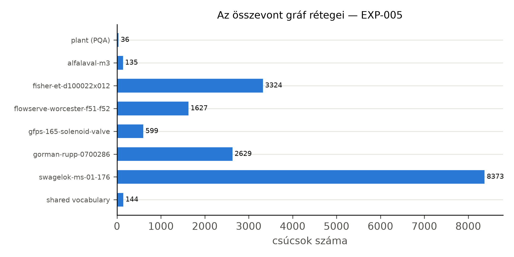

# Az összevont tudásgráf

A két egyéni munka két külön gráfot épít: a rajzból egy üzemi réteget (Benedek), az adatlapokból
eszközönként egy-egy adatlapgráfot (plantdocs). Az összevonás célja, hogy egyetlen adatbázisban
egyetlen lekérdezés mindkettőt elérje. Ebben a fejezetben előbb a két forrásfolyamatot mutatjuk
be olyan részletességgel, amennyi a gráfok szerkezetének megértéséhez kell, utána a két réteget, a
köztük lévő kapcsolatot és a betöltés mérését. A két folyamat kódját nem módosítottuk; amit
leírunk, az a két forrásrepó tervezési jegyzeteiből és kódjából származik.

## A rajzoldali forrás: a plantgraph folyamata

Benedek rendszerében a generátor egy teljes üzemet épít, a lapokra bontó (splitter) lapokra
vágja, a feloldó (resolver) a lapokból megoldókulcs nélkül visszaépíti az üzemet, végül a betöltő
Neo4j-be tölti. Mivel a bontást a rendszer maga végzi, pontosan tudható, melyik lapközi csatlakozó
melyikkel alkot párt, és ehhez mérhető a feloldó.

### Az üzemgenerátor

A generátor minden véletlen döntést egyetlen seedelt véletlenszám-generátoron át hoz meg, ezért
ugyanaz a seed ugyanazt az üzemet adja; a kimenet valódi pyDEXPI-modell. Az üzem egységekből
(unit) áll. Egy egységen belül a berendezéseket sorban veszi fel, és mindegyik új berendezés
véletlenszerűen választ szülőt a már meglévők közül, amelytől anyagáram fut hozzá (véletlen
rekurzív fa); így elágazó, nem lánc alakú topológia jön létre. Ezt három, valószínűséggel
vezérelt kiegészítés teszi valószerűbbé: egy későbbi berendezésből visszaforgató ág futhat egy
korábbiba, minden új egység egy korábbi egység egyik berendezéséből kap bemenő áramot, és egy
korábbi egységből kereszt-kapcsolat is futhat egy későbbi egység belsejébe.

Az áramokra szelepek kerülnek, a berendezésekhez pedig adott valószínűséggel szabályozókör
tartozik: mérő (távadó), szabályozó, működtető és a szabályozott szelep. A tagek a szokásos
betűket követik: a kör változója F, L, P vagy T, a távadó `FT-…`, a szabályozó `FIC-…`, a
szabályozott szelep `FV-…`. A generátor terve kifejezetten elveti a véletlen címkéjű véletlen
gráfot: a berendezések az áramok végén állnak, a szelepek az áramokon ülnek, a szabályozókörök a
berendezésekhez tartoznak, és csak ettől lesz értelme egy „mi táplálja ezt a szivattyút?”
kérdésnek. Benedek két generátort készített; a mi példaüzemünk a v1 generátorral készült, mert a
valósághűbb folyamatmintákat (oszlop, reaktor, biztonsági szelep) adó v2 generátor
berendezésosztályai nem szűkíthetők az adatlappal rendelkező osztályokra (`docs/felmeres.md`).

A generátor minden mezőt megjelöl aszerint, hogy látható-e a vizsgált rendszer számára: látható a
tag, az osztály, a vezetékszám és a csatlakozó felirata, rejtett a belső azonosító és az áram
fajtája, mert ilyen jelölés egy valódi rajzon nincs. Ha egy több lapon felrajzolt berendezés minden
előfordulása ugyanazt a belső azonosítót viselné, a feloldónak nem kellene semmit kitalálnia, ezért
minden előfordulás átlátszatlan azonosítót kap.

### A lapokra bontó és a lapközi csatlakozók

A lapokra bontó egy teljes üzemgráfot vág lapokra egy lapkeret szerint, és minden elvágott élre
egy lapközi csatlakozópárt illeszt: a forrás lapján egy kimenő, a cél lapján egy bejövő
csatlakozót, amelyek felirata megnevezi a partner lapot és csatlakozót. A bontás
stratégiája egy közös felület mögött cserélhető: az alapértelmezett a folyamat irányát követi, és
a lapot a keretéig tölti; más stratégiák egységek szerint vagy közösségkereséssel vágnak, illetve
a segédközegeket külön lapokra teszik; egy véletlen stratégia pedig kontrollként szolgál. A bontó csak
lapgráfokat állít elő; a rajzexport külön komponens.

A laphatár kétféle kapcsolatot vághat el, és a bontó mindkettőt előállítja (lásd az alábbi
táblázatot). A megoldókulcsot (csatlakozópárok, azonossági csoportok) külön fájlba írja, amely a
vizsgált adatbázisba nem kerül be; a lapokból és a megoldókulcsból pontosan az eredeti gráfnak
kell visszaállnia.

Táblázat: A két lapközi mechanizmus (Benedek lapokra bontó tervjegyzete alapján)
| | Lapközi csatlakozó | Tag-azonosság |
|---|---|---|
| Mi vágódik el | egy cső: egy él két részre | egy elem: egy csúcs két lapon |
| Visszaállítás | az elvágott él újraösszekötése | a duplikált csúcsok összevonása |
| Jel a rajzon | a csatlakozó felirata a partner lappal | az elem tagje |
| Ha elmarad | a gráf szétesik, a hiba látható | a gráf épnek látszik, a válaszok hiányosak |

A példaüzem 4 lapja között 4 lapközi csatlakozópár van (EXP-002); a rajzexportban mind a 8
lapközi jel összekötött (EXP-003).

### A feloldó

A feloldó bemenete csak a lapok sorozata; a megoldókulcsot nem látja. A csatlakozók
feliratából két csatlakozó akkor lesz pár, ha kölcsönösen egymásra hivatkoznak (mindkettő a másik
lapját és csatlakozószámát nevezi meg); a maradékot a vezetékszám és a közegkód szerint
csoportosítja, és csak akkor párosít, ha egy csoportban pontosan egy kimenő és egy bejövő
csatlakozó van. Minden más feloldatlan marad, megnevezett okkal; a feloldó nem találgat.

Az azonossági csoportokat a (tag, osztály) kulcs adja: ha egy ilyen kulcs két vagy több lapon
fordul elő, az előfordulások egy elemet jelentenek. Alapértelmezésben csak berendezéseket von
össze, és csak pontos egyezéssel. Végül az összefésülés minden csoportot a legtöbb tulajdonságot
hordozó előfordulásával helyettesít, a csatlakozópárokon át újraköti az elvágott éleket, a
párosítatlan csatlakozókat pedig meghagyja, hogy a hiány a kapuellenőrzésben látsszon. A legfőbb
kapu az egyezés: a feloldott üzemnek az eredeti üzem látható nézetével kell megegyeznie; egy
átnevezési próba pedig azt ellenőrzi, hogy az eredmény nem függ az átlátszatlan azonosítóktól. A
példaüzemen a visszaépítési ellenőrzés hibátlan volt (EXP-002).

### Az üzemi réteg és a vonalnézet

Benedek döntése (ADR-0036) szerint az adatbázisban két réteg lehet: a rajz szerinti
előfordulásréteg (rajzolt szimbólumok, lapközi csonkok, azonossági élek) a nyomon követésre, és az
összevont üzemi réteg, a tulajdonképpeni tudásgráf, amely kizárólag a feloldó kimenetéből épül.
Az üzemi rétegben egy laphatár átlépése egyetlen él, az előfordulásrétegben több lépéses minta.

A generált üzemet Benedek betöltője tölti Neo4j-be, a kaszkád által olvasott `plant_lines`
profillal. Minden rajzi elem egyetlen `(:PlantItem)` csúcs, akárhány lapon szerepel is;
osztálycímkéi a konkrét osztálytól a családig terjednek (például
`:PlantItem:CentrifugalPump:Pump:Equipment`). Az anyagáramot a `send_to` kapcsolat írja le,
csőrészenként; a lapot átlépő kapcsolat `crossed_sheets` tulajdonságot kap. A jelutakat a
`send_signal_to`, a mérést a `measured_by`, a beavatkozást a `control` kapcsolat ábrázolja; az
elemek lapjait és egységeit `is_drawn_on` és `is_located_in` kapcsolat köti a szerkezeti
csúcsokhoz.

A `plant_lines` profil egy vonalnézettel bővíti ezt (ADR-0061). A `line_to` kapcsolat két
berendezést vagy szelepet köt össze akkor is, ha köztük jelöletlen idomok vagy beépített
komponensek vannak; az átugrott elemeket a kapcsolat `via_tags` és `n_fittings` tulajdonsága
őrzi. Minden elem `kind` tulajdonságot kap, a szelepek közös `Valve` címkét, és a be- vagy
kimenő áram nélküli elemek vonalvégként jelöltek. A `send_to` megmarad, így a csőrészenkénti
nézet sem vész el. A vonalnézetet Benedek a valósághűbb v2 üzemekhez vezette be, ahol sok
jelöletlen idom áll az elemek között; a mi v1 példaüzemünkön ilyen idom nincs, de a kaszkád
promptjai és lekérdezési szabályai erre a profilra készültek, ezért ezt használjuk. A példaüzem
üzemi rétege 36 csúcsból és 116 kapcsolatból áll (EXP-005).

## Az adatlapoldali forrás: a plantdocs folyamata

A plantdocs egy gyártói adatlap PDF-jéből tíz számozott lépésben jut el az ontológia szerinti
RDF-gráfig. A lépések felváltva programok és nyelvi modellek; minden nyelvimodell-lépésnek
verziózott promptja van, és a kimenete csak akkor mehet tovább, ha átmegy a lépés szerződésén (egy
programmal ellenőrzött formai és tartalmi feltételrendszeren). A programlépéseket egy
visszamenőleges teszt újrafuttatja és összeveti a tárolt kimenettel. A lépéseket az alábbi
táblázat foglalja össze.

Táblázat: A plantdocs folyamatának lépései (a plantdocs 0007-es tervezési jegyzete alapján)
| # | Ki végzi | Mit csinál |
|---|---|---|
| 01 | Azure Document Intelligence | oldalelrendezés, táblázatok és ábrák felismerése |
| 02 | nyelvi modell | rekordok: paraméter, érték, egység, a táblázatbeli útvonal |
| 03 | program, nyelvi modell, program | ábrák kivágása és osztályozása, a betű- és számjelek feloldása |
| 04 | program, nyelvi modell, program | diagramoldalak, leolvasás, vektoros ellenőrzés |
| 05 | program | a rekordok ellenőrzése a PDF szövegével |
| 06 | nyelvi modell, program | célformátum: tények, feltételek, lábjegyzetek, diagramok |
| 07 | program | az ábrákhoz tartozó lábjegyzetek |
| 08 | program, nyelvi modell, program | forrásleltár és forrásleírások, a végső célformátum |
| 09 | program, nyelvi modell, program | szókészlet: illesztés, hálózati ellenőrzés, szókészlet-térkép |
| 10 | program | RDF: IDO és POSC Caesar adatlap-ontológia |

### A lépések

Az **01.** lépés az Azure Document Intelligence elrendezés-elemzése (bekezdések, táblázatok,
ábrák); a plantdocs ezt adott eszköznek tekinti, nem kutatási hozzájárulásnak (plantdocs README).
A **02.** lépésben egy nyelvi modell rekordokat ír: paraméter, érték, egység és a táblázatbeli
útvonal (táblázatcím, sor- és oszlopfejlécek) a lábjegyzetjelekkel. Ezek még lapos szövegek.

A **03.** lépés az ábrákat kivágja és osztályozza (fénykép, metszeti rajz, méretrajz, diagram),
és a rajzokon a betű- és számjeleket alkatrésznevekhez vagy táblázatfejlécekhez köti; amit nem tud
feloldani, azt feloldatlanként megtartja. A **04.** lépés a diagramokat olvassa le: egy
szelepdiagram üzemi tartományok sokszögeiből, egy görbediagram pontsorozatokból áll; ahol lehet, a
leolvasást a PDF vektoros vonalaival ellenőrzi, és a diagram fölötti címsorok feltételeit a
diagramhoz rendeli. Az **05.** lépés minden rekord számát megkeresi a hivatkozott PDF-oldal
szövegében.

A **06.** lépés hozza létre a célformátumot (lásd alább). Ehhez a plantdocs hibrid módszert
használ: a program a rekordok útvonalát szegmensekre bontja, egy nyelvi modell táblázatonként
egyszer megadja, melyik szegmens az alany, melyik a feltétel és melyik a tulajdonság (táblázatséma),
és egy determinisztikus lépés ezt minden rekordra alkalmazza. Ez olcsóbb, mint rekordonként
kérdezni, és egy táblázaton belül következetes. A **07.** lépés az ábrák lábjegyzeteit köti be, a
**08.** lépés minden forrásról rövid leírást írat; ezek a lekérdezésnél a szakaszkatalógus sorai
lesznek.

A **09.** lépés a szókészlet-illesztés. Egy nyelvi modell minden eszköztulajdonsághoz és
feltétel-dimenzióhoz szabványos fogalmat keres, a program minden javasolt azonosítót újra
lekérdez a hálózaton, és csak az ellenőrzött illesztés kerül a szókészlet-térképbe. A sorrend
rögzített: előbb a POSC Caesar könyvtár pontos vagy tágabb fogalma, ha nincs, a CFIHOS-é; modell-
vagy változatkódnál a könyvtár azonosítási osztálya; különben az IDO legáltalánosabb
tulajdonság-osztálya (`Quality`) mint gyűjtő, ahol a pontos jelentést a nyomtatott címke
hordozza. A gyűjtőbe kerülő tények aránya az illesztés minőségének jelzője. Az illesztés
lefedettségét a plantdocs egy előzetes mérése vizsgálta: négy dokumentum eszköztulajdonságai és
feltétel-dimenziói közül 88/133-hoz adott a POSC Caesar könyvtár pontos vagy tágabb fogalmat, a
CFIHOS-szal együtt 101/133-hoz (a plantdocs `_results.md` szerint, EXP-0022; előzetes, kézi
ellenőrzésre váró eredmény). A mi feldolgozásunkban a POSC Caesar régi SPARQL-végpontja
HTTP 404-et adott, ezért a régi könyvtárral nem, csak az új végponttal és a CFIHOS-szal
illesztettünk (EXP-006). Végül a **10.** lépés program: a végső célformátumot és a
szókészlet-térképet RDF-gráffá alakítja, és jelentést ír a tények szintek szerinti eloszlásáról.

Az általunk feldolgozott négy adatlapon mind a 24 nyelvimodell-kimenet elsőre átment a plantdocs
szerződésein (EXP-006).

### A célformátum

A célformátum a kinyerés és a gráfépítés között álló, ontológiafüggetlen rekordformátum. Öt elvre
épül (a plantdocs 0003-as tervezési jegyzete szerint):

1. Egy rekord egy tény, nem egy nyomtatott cella: ugyanannak a ténynek a két mértékegységben
   nyomtatott cellája egy rekord két nyomtatott értékkel.
2. A feltételek elsőrendű elemek, egy lista, nem egy név része. Egy tény a feltételei nélkül nem
   hiányos, hanem hibás.
3. Semmit nem javít csendben: a nyomtatott forma megmarad, a gyanús elírás jelzőt kap, és nem
   íródik felül.
4. Minden visszakövethető a forrásrekordokig és a PDF-oldalig.
5. A mutató nem érték: a kereszthivatkozás és a lábjegyzetjel típusos, hogy a gráfban él
   lehessen belőle.

Egy tényrekord vázlata a következő (a mezőnevek a plantdocs formátumáé, az értékek helyén
leírás áll):

```
{
  "subject":    {"label": "<az alany, ahogy nyomtatva van>", "kind": "<alkatrész fajtája>"},
  "property":   {"label": "<a tulajdonság nyomtatott neve>", "key": "<rövid kulcs>"},
  "value_type": "quantity | code | text | reference | not_limiting | expression",
  "values":     [{"value": "<szám>", "unit": "<egység>", "printed": "<ahogy nyomtatva van>"}],
  "conditions": [{"dimension": "<feltétel-dimenzió>", "any_of": ["<megengedett értékek>"]}],
  "footnotes":  ["<lábjegyzetrekordok azonosítói>"],
  "flags":      ["<például gyanús elírás, a mértékegység-pár nem egyezik>"],
  "source":     {"document": "<dokumentum>", "page": "<PDF-oldal>", "table": "<táblázat>"}
}
```

Az értéktípus megkülönbözteti a mennyiséget (erre illeszkedik a QUDT), a kódot (anyagjel,
nyomásosztály), a szabad szöveget, a hivatkozást (egy másik táblázatra mutat, értéke nincs), a
„nem korlátozó” jelölést (ami információ, nem hiány) és a képletet. A kimeneti fájl hat listát
tartalmaz: tények, lábjegyzetek, ábrák, ábra–alkatrész kapcsolatok, diagramok és indoklással
kihagyott rekordok; minden bemeneti rekord pontosan egy helyre kerül, semmi nem veszhet el
csendben. A lábjegyzetben kimondott tények önálló tények, amelyek a lábjegyzetükre is
visszamutatnak.

### Az RDF-modell

A plantdocs ontológiai döntése (ADR-0005) az ISO 15926 vonal: az IDO a felső ontológia, a POSC
Caesar könyvtára az eszköz- és referenciaszótár, a mértékegység QUDT. A döntés mellett szólt,
hogy szabványos és nyílt, és hogy a DEXPI is innen indul; ellene a tanulási görbe, és hogy a
könyvtár eszközmodulja nem ad teljes tulajdonságkatalógust. A legfontosabb megkötés az, hogy
saját, kézzel írt szókészlet nem lehet: minden osztály és tulajdonság szabványos azonosító, ami
pedig a dokumentumból jön (címke, érték, feltétel), az adat, nem szókészlet. Ha nincs pontos
szabványos fogalom, a legközelebbi tágabb kerül a gráfba, a pontos jelentést a dokumentum
szövege hordozza. A rétegeket az alábbi táblázat mutatja.

Táblázat: Az adatlapgráf rétegei (a plantdocs 0006-os tervezési jegyzete alapján)
| Réteg | Szabvány | Mire |
|---|---|---|
| Nyelvtan | IDO, `lis:` előtag | fizikai tárgy, rész–egész, információs tárgy, érték és egység |
| Adatlap-szerkezet | POSC Caesar adatlap-ontológia | adatlap, bejegyzés (datum), alany, attribútum, eset, szakasz |
| Eszközosztály | POSC Caesar könyvtár | például szolenoidszelep, centrifugálszivattyú |
| Tulajdonság, feltétel-dimenzió | POSC Caesar könyvtár, ahol nincs: CFIHOS | például névleges átmérő |
| Mértékegység | POSC Caesar egységmodul és QUDT | azonosító, illetve mennyiségfajta és átváltás |
| Egyéb | Dublin Core, SKOS, schema.org | leírás, jelölés, oldalszám |

A leképezés a célformátumból a gráfba a következő. Az eszköz egy `lis:PhysicalObject` csúcs a
POSC Caesar eszközosztályával; az alkatrészek szintén fizikai tárgyak, `lis:partOf` kapcsolattal
az eszközre. Egy mennyiségi tény mennyiségi adatpont (Quantity Datum) a számmal, a mértékegységgel
és tartomány esetén alsó és felső határral; egy szöveges vagy kód jellegű tény attribútum-adatpont
(Attribute Datum); ha az érték maga szabványos osztály (például egy anyag), osztályozó adatpont
(Classification Datum). Minden adatpont hordozza a nyomtatott címkét és értéket, a PDF-oldalt,
az alanyát és, ha van, a szabványos attribútumát.

A feltételek együttese egy esetcsúcs (Case), amelyet a POSC Caesar úgy határoz meg, mint egy
helyzetet, amelyen belül bizonyos attribútumértékek érvényesek. A tény egy kapcsolattal az esetre
mutat, az eset címkéje felsorolja a feltételeket, és minden egyes feltétel maga is adatpont, amely
ugyanerre az esetre mutat, a dimenzió szabványos attribútumával. A forrás (táblázat, ábra,
diagram, szövegrész) szakaszcsúcs (Section Datum) a címmel, a 08. lépés leírásával és az
oldalszámmal; a lábjegyzet külön adatpont, amelyre a tény kapcsolattal mutat. A diagramok
pontjai pontonként egy-egy esetbe kerülnek.

Miért eset, és nem valami más? A feltételes tény n-áris, ezért kell egy csúcs, amely a feltételeket
összefogja (2. fejezet). A plantdocs megvizsgált egy saját tény-csúcsot is, de a POSC Caesar
adatlap-mintája ugyanezt szabványosan tudja, a saját szókészlet pedig ki volt zárva. Mérlegelte az
IDO áram-mintáját is, amely az üzemi környezetet (nyomás, hőmérséklet, közeg) egy áramként
modellezi, amelynek a szelep résztvevője; ez azonban egy üzemi helyre vonatkozó előírást ír le,
nem egy gyártói adatlap feltételeit. A döntés végül az egységesség volt: minden
feltétel-kombináció eset. Ennek ára, hogy az „eset” szót a szabvány elsősorban feltételezett
helyzetekre használja, a plantdocs pedig termékváltozatokra és üzemi feltételekre is.

### Az adatlapréteg a Neo4j-ben

Egy adatlapgráf a plantdocs RDF-kimenete, amelyet a neosemantics (n10s) bővítmény tölt be:
minden csúcs `:Resource {uri}`, az RDF-típusok további címkék (például a mennyiségi adatpont
címkéje `plm__PCA_100029511`), a szabványos azonosítók rövidített előtagos neveket kapnak. Az
eszköz gyökércsúcsának URI-ja `urn:plantdocs:<doc>:device`. Az adatpontok az eszközre vagy egy
alkatrészére mutatnak, a feltételeket esetcsúcs, a lábjegyzeteket külön adatpont, a forrást
(táblázat, ábra, szakasz) forrásszakasz-csúcs hordozza oldalszámmal. Ez a szerkezet őrzi meg,
hogy egy érték milyen feltétel mellett és melyik oldalon érvényes. A hét eszközgráf együtt
27 615 csúcsból és 103 366 kapcsolatból áll; a közös szókészlet-csúcsok (egységek, osztályok,
szabványos attribútumok) száma 221 (EXP-005).



## Az összekötés

A két réteget egy kapcsolat köti össze: `(:PlantItem {tag})-[:DESCRIBED_BY]->(eszköz)`. A
kapcsolatot a program által előállított tag → adatlap tábla alapján töltjük be; a 26 tagelt
elemből 24-nek van adatlapja, ennyi `DESCRIBED_BY` él jön létre (EXP-002, EXP-005). Több tag
mutathat ugyanarra az eszközgráfra: a nyolc szivattyú ugyanazt a Gorman-Rupp adatlapot kapja,
mert ugyanaz a típus. A névütközést az URI-k dokumentumonkénti előtagja zárja ki; emellett
minden adatlapcsúcs `document_id` tulajdonságot kap, amellyel a lekérdezés egy dokumentumra
szűkíthető. A közös szókészlet-csúcsok (például egy mértékegység) az eszközök között közösek.

Egy összetett kérdés így egyetlen bejárásként fogalmazható meg: a rajzi rétegben megkeressük a
kérdéses elemet (például a P-1-1 utáni első szelepet a `line_to` mentén), a `DESCRIBED_BY`
kapcsolaton átlépünk az adatlapjára, és ott a megfelelő adatpontot olvassuk ki a feltételével és
az oldalszámával. Az alábbi minta az összevont gráf egy részletét mutatja Cypher-jelöléssel: egy
szivattyút, a rajzi szomszédját, az adatlapja gyökércsúcsát és egy adatpontot a környezetével.

```
// rajzi réteg (Benedek, plant_lines profil)
(p:PlantItem:CentrifugalPump {tag: 'P-1-3'})-[:line_to]->(v:PlantItem:Valve)
(p)-[:is_drawn_on]->(:Sheet)

// az összekötés
(p)-[:DESCRIBED_BY]->(dev:Resource:lis__PhysicalObject)

// adatlapi réteg (plantdocs, egy adatpont a környezetével)
(d:plm__PCA_100029511)-[:plm__PCA_100029516]->(dev)                 // alany: az eszköz vagy egy alkatrésze
(d)-[:plm__PCA_100029520]->(c:plm__PCA_100029524)                   // eset: a feltételek együttese
(cond:plm__PCA_100029508)-[:plm__PCA_100029520]->(c)                // egy feltétel ugyanabban az esetben
(d)-[:plm__PCA_100029525]->(s:plm__PCA_100029513)                   // forrásszakasz, oldalszámmal
(d)-[:plm__PCA_100029514]->(f:plm__PCA_100029505)                   // lábjegyzet
(d)-[:lis__datumUOM]->(u:Resource)                                  // mértékegység, QUDT-megfeleltetéssel
```

Az összekötés módját több alternatívával szemben választottuk. A legegyszerűbb az lett volna, ha
az adatlapi tényeket tulajdonságként a rajzi csúcsra másoljuk; ez azonban éppen a feltételeket,
a lábjegyzeteket és az oldalszámot veszítené el, amelyekért a plantdocs gráfja készült. Két
külön adatbázis között egy lekérdezés nem járhat át (és a helyi Neo4j Community kiadás csak egy
felhasználói adatbázist enged); az egész gráf RDF-ben pedig Benedek Neo4j-re írt kaszkádjának
módosítását igényelte volna. A
tagalapú él a legkisebb beavatkozás: egyik réteg szerkezete sem változik, és a kapcsolat a
gyakorlatot követi, ahol a tag köti össze a rajzot a többi dokumentummal. Ára, hogy a tag →
adatlap táblát elő kell állítani; nálunk ezt program végzi a generátor kimenetéből (3. fejezet),
valódi üzemben ez az eszközlista vagy az átadási adatbázis dolga volna.

## Betöltés

A betöltés egy paranccsal újrafuttatható (`python -m plantqa.graph.load`). Sorrendje: az
adatbázis törlése és a neosemantics beállítása, az eszközgráfok betöltése és névtérbe sorolása,
az üzemi réteg betöltése Benedek betöltőjével (amely csak a saját korpuszát törli), a
`DESCRIBED_BY` élek, végül a plantdocs A2 vektoros kereséséhez szükséges beágyazások. A teljes
betöltés 243,2 s; ennek nagy része (222,4 s) a 14 489 beágyazás előállítása, tárolása és indexelése, az üzemi
réteg 3,6 s alatt töltődik be (EXP-005). A helyi Neo4j Community kiadás csak egy felhasználói
adatbázist enged, ezért a betöltő minden futáskor az egész adatbázist újraépíti.

Két illesztési pontra külön figyelni kellett. Benedek tárellenőrzése összeveti az adatbázis
kapcsolatszámait a betöltési tervvel, és eltérésnél nem indítja el a kaszkádot; ezért a kaszkád egy
leszármazott nézeten át olvas, amely a `DESCRIBED_BY` kapcsolatot nem számolja a rajzi
korpuszhoz. A másik pont a plantdocs: az alkalmazása dokumentumonként törli és
újratölti az adatbázist, ami az összevont gráfot tönkretenné. Ezért az A2-t nem az alkalmazáson
át hívjuk, hanem közvetlenül a lekérdező függvényét, egy dokumentumra szűkítő lekérdezés-futtatóval
(5. fejezet).
