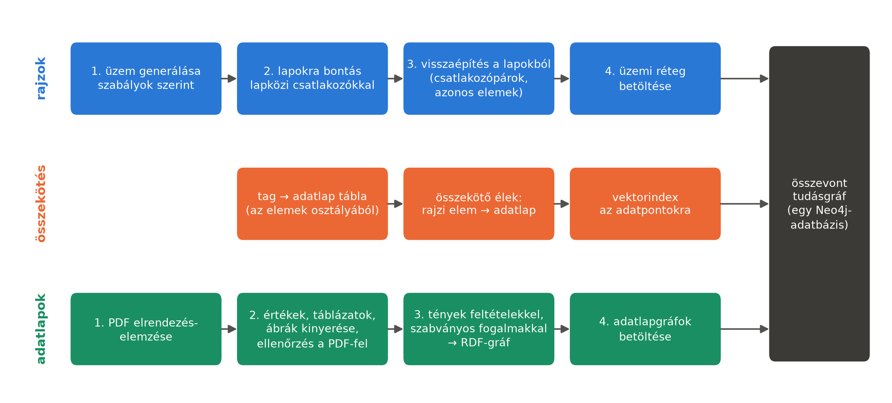
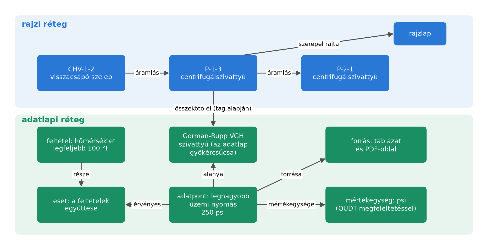

# Az összevont tudásgráf

Az előző fejezetben leírt kérdések egy része csak úgy válaszolható meg, ha a rajz és az adatlap
egyszerre elérhető. Ebben a fejezetben bemutatjuk, hogyan épül fel az a tudásgráf, amely mindkettőt
tartalmazza. A két forrásrendszer két külön gráfot épít: a plantgraph a rajzokból egy üzemi
réteget, a plantdocs az adatlapokból eszközönként egy-egy adatlapgráfot. Az összevonás célja, hogy
a kettő egyetlen adatbázisba kerüljön, és egyetlen lekérdezés mindkettőt elérje. A folyamat három
ágát az alábbi ábra foglalja össze: a felső ág a rajzokból, az alsó az adatlapokból épít gráfot, a
középső ág pedig összeköti a kettőt. A három ág kimenete ugyanabba a Neo4j-adatbázisba kerül. A
fejezetben sorra vesszük a három ágat; a két forrásfolyamat részletes leírása a Függelék D-ben
található.

## A rajzi réteg

A rajzi ág négy lépésből áll. Először a generátor szabályok szerint felépít egy teljes üzemet:
egységeket, bennük berendezéseket, a köztük futó csővezetékeket a szelepekkel, és a
berendezésekhez tartozó szabályozóköröket. Másodszor egy lapokra bontó program az üzemet rajzlapokra
vágja, és minden elvágott csőre lapközi csatlakozópárt illeszt, ahogy egy valódi rajzon is
történik; azt, hogy melyik csatlakozó melyikkel alkot párt, külön megoldókulcsba írja, amely a
vizsgált adatbázisba nem kerül be. Harmadszor egy visszaépítő program csak a lapokból, a
megoldókulcs nélkül állítja vissza az üzemet: a csatlakozókat a feliratuk kölcsönös hivatkozása
alapján párosítja, a több lapon felrajzolt elemeket a tag-jük és az osztályuk alapján egy elemmé
vonja össze, és bizonytalan esetben nem találgat. Mivel a bontást a rendszer maga végezte, a
visszaépítés eredménye a megoldókulccsal összevethető; a prototípus-üzemen hibátlan volt.
Negyedszer a visszaépített üzem bekerül az adatbázisba.

Az adatbázisban minden rajzi elem pontosan egy csúcs lesz, akkor is, ha több lapon is szerepel. A
csúcs több szinten is hordozza az elem típusát: egy centrifugálszivattyú egyben szivattyú és
berendezés is, így egy lekérdezés bármelyik szinten rákereshet. Az elemek közötti csöveket az
áramlás irányába mutató élek írják le, és ha egy cső átlépi a laphatárt, az is egyetlen él, amely
ezt a tényt megjegyzi. A jelvezetékeknek, a mérésnek (melyik távadó melyik elemet méri) és a
beavatkozásnak (melyik szabályozó melyik szelepet működteti) külön éltípusa van, és minden elem
kapcsolatban áll azzal a lappal, amelyen szerepel, és azzal az egységgel, amelyhez tartozik.

Erre épül a vonalnézet: egy rövidítő él, amely két berendezést vagy szelepet közvetlenül köt össze,
és átugorja a köztük lévő kisebb csőidomokat. Így az olyan kérdés, mint „mi a szivattyú utáni
következő szelep?”, egyetlen lépésben megválaszolható, a csövenkénti élek pedig a részletes
nézethez megmaradnak. A vonalnézet a generátor valósághűbb változatához készült, ahol sok jelöletlen
idom áll az elemek között; a mi üzemeinkben ilyen idom nincs, de a kaszkád lekérdezési szabályai
erre a nézetre épülnek, ezért ezt használjuk. A kis prototípus-üzem rajzi rétege 36 csúcsból és 116
élből áll.

## Az adatlapi réteg

Az adatlapi ágban a plantdocs egy gyártói adatlap PDF-jéből tíz számozott lépésben állítja elő az
adatlapgráfot. Az ábra négy dobozában ezek a lépések csoportosítva szerepelnek: az első doboz az 1.
lépés, a második a 2–5., a harmadik a 6–10. lépés, a negyedik a betöltés.

1. elrendezés-elemzés az Azure Document Intelligence szolgáltatással (bekezdések, táblázatok, ábrák);
2. rekordok: egy nyelvi modell a táblázatokból paraméter–érték–egység rekordokat ír, a
   táblázatbeli helyükkel együtt;
3. ábrák: kivágás, osztályozás és a rajzokon lévő jelek feloldása;
4. diagramok leolvasása;
5. ellenőrzés: minden rekord számának megkeresése a PDF szövegében;
6. célformátum: a rekordokból tények és a hozzájuk tartozó feltételek;
7. lábjegyzetek: az ábrákhoz tartozó lábjegyzetek bekötése;
8. forrásleírások: minden forrásról (táblázatról, ábráról, szövegrészről) rövid leírás;
9. szókészlet-illesztés: a tulajdonságokhoz és feltételekhez szabványos fogalmak rendelése;
10. az RDF-gráf előállítása.

A lépések felváltva programok és nyelvi modellek. Egy nyelvimodell-lépés kimenete csak akkor mehet
tovább, ha átmegy egy programmal ellenőrzött formai és tartalmi feltételrendszeren; az általunk
feldolgozott négy adatlapon minden ilyen kimenet elsőre átment. A folyamat legfontosabb elve, hogy
egy rekord egy tény, nem egy nyomtatott cella, és a tény feltételei önálló elemek. A gráf a 2.
fejezetben bemutatott ISO 15926 vonalat követi: az alapfogalmakat az IDO, az eszköz- és
tulajdonságosztályokat a POSC Caesar könyvtára, a mértékegységeket a QUDT adja, és saját, kézzel
írt szókészlet nem lehet benne.

Hogy ez a gyakorlatban mit jelent, azt a második ábra alsó fele mutatja. Az adatlap gyökércsúcsa
maga az eszköz (itt a Gorman-Rupp VGH szivattyú). Egy mennyiségi tény egy adatpont-csúcs, amely a
nyomtatott címkét és értéket hordozza, és élekkel mutat az alanyára (az eszközre vagy egy
alkatrészére), a mértékegységére és a forrására, vagyis arra a táblázatra, ábrára vagy
szövegrészre, ahonnan származik, az oldalszámmal együtt. A feltételek együttese egy külön
esetcsúcs: a tény erre az esetre mutat, és minden egyes feltétel (például „a hőmérséklet
legfeljebb 100 °F”) maga is adatpont, amely ugyanerre az esetre mutat. A lábjegyzet szintén külön
adatpont. Ez a szerkezet őrzi meg, hogy egy érték milyen feltétel mellett és melyik oldalon
érvényes; a példában a 250 psi-s legnagyobb üzemi nyomás csak 100 °F-ig érvényes, és a gráfból ez
a feltétel is kiolvasható.

Az adatlapgráfokat egy bővítmény tölti be a Neo4j-be, amely az RDF-hármasokat csúcsokká és élekké
alakítja. A hét eszközgráf együtt 27 615 csúcsból és 103 366 élből áll; ehhez jön 221 közös
szókészlet-csúcs (mértékegységek, eszközosztályok, szabványos tulajdonságok), amelyeken az adatlapok
osztoznak.

## Az összekötés

A középső ág köti össze a két réteget. Első lépése egy tábla, amely minden tagelt rajzi elemhez
megadja az adatlapját. Ezt a táblát program állítja elő a generátor kimenetéből, az elem osztálya és
szerepe alapján (3. fejezet); valódi üzemben ez az eszközlista vagy az átadási adatbázis dolga
volna. A tábla alapján minden adatlappal rendelkező rajzi elemtől egy összekötő él fut az
adatlapgráf gyökércsúcsához. A kis üzem 26 tagelt eleméből 24-nek van adatlapja, ennyi összekötő él
jön létre. Több tag mutathat ugyanarra az adatlapgráfra: a nyolc szivattyú mind a Gorman-Rupp
adatlapot kapja, mert ugyanaz a típus. Az adatlapok csúcsai nem keverednek össze, mert minden csúcs
azonosítója a dokumentum azonosítójával kezdődik, és minden csúcs külön tulajdonságként is hordozza
a dokumentumazonosítót, így egy lekérdezés egyetlen adatlapra szűkíthető. Az utolsó lépés egy
vektorindex az adatlapi adatpontokra, amely a jelentés szerinti kereséshez kell: minden adatpont
szövegéhez egy beágyazásvektor készül, és a kérdéshez legközelebbi vektorok gyorsan
megkereshetők.

Az ábra azt is megmutatja, hogyan válaszolható meg így egy összetett kérdés egyetlen bejárással.
A „mekkora a CHV-1-2 szelep utáni szivattyú legnagyobb üzemi nyomása?” kérdéshez a rajzi rétegben
a CHV-1-2-től az áramlás irányában egy lépést teszünk, és megtaláljuk a P-1-3 szivattyút; az
összekötő élen átlépünk az adatlapjára; ott kiolvassuk az adatpontot a feltételével és a
forrásoldalával együtt. Nincs szükség arra, hogy a rajzi és az adatlapi rendszer szövegesen adja
át egymásnak az eredményt.

A fenti oszlopdiagram a prototípus-üzem összevont gráfjának összetételét mutatja. Minden oszlop azt
adja meg, hány csúcs származik az adott forrásból: az első a rajzból épített üzemi réteg 36
csúcsa, a következő hét egy-egy adatlap gráfja, az utolsó a közös szókészlet. Az adatlapgráfok
mérete az adatlap terjedelmét követi: a 114 oldalas Rosemount 3051 adatlapból 10 928, a kétoldalas
Alfa Laval M3-ból 135 csúcs lesz. Az adatlapi réteg tehát a kis üzemen nagyságrendekkel nagyobb a
rajzinál, és mérete nem függ az üzemtől; a nagyobb üzemeken csak a rajzi réteg és az összekötő élek
száma nő (6. fejezet).

Az összekötés módját több lehetőség közül választottuk. A legegyszerűbb az lett volna, ha az
adatlapi tényeket tulajdonságként a rajzi csúcsra másoljuk; ez azonban éppen a feltételeket, a
lábjegyzeteket és az oldalszámot veszítené el, amelyekért az adatlapgráf készült. Két külön
adatbázis között egy lekérdezés nem járhat át, az egész gráf RDF-formában pedig a Neo4j-re írt
kaszkád átírását igényelte volna. A tag alapján húzott él a legkisebb beavatkozás: egyik réteg
szerkezete sem változik, és a kapcsolat a gyakorlatot követi, ahol a tag köti össze a rajzot a
többi dokumentummal. Az így kapott gráf a kiindulópont; a következő fejezet azt mutatja be, hogyan
válaszol rajta a három kérdés-válaszoló módszer.
