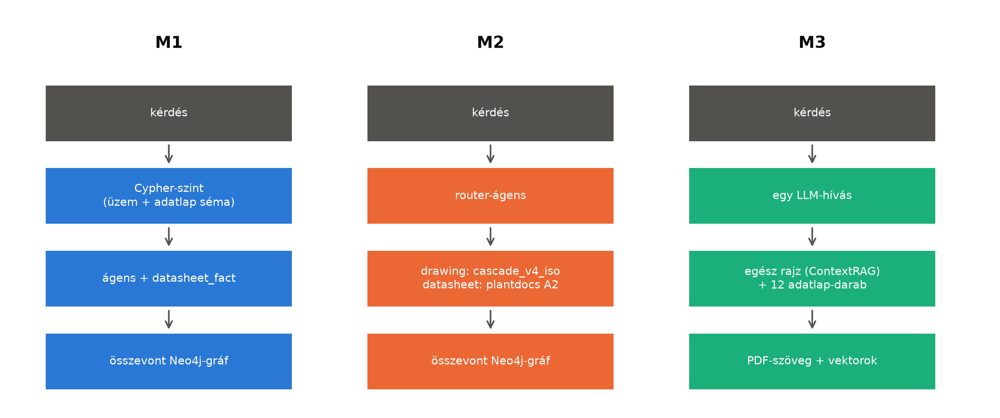

# Kérdés-megválaszolási módszerek

Három módszert hasonlítunk össze. Mindhárom a két meglévő rendszerre épül, azokat nem
módosítja: a kódjukat importáljuk, és csak a hiányzó kapcsolatot írjuk meg. A három módszer
ugyanazt a kérdést kapja (szöveg és elvárt válaszalak), és ugyanabban az alakban válaszol:
egy JSON-objektum a válasszal és egy jelzővel arra, hogy a dokumentumok nem tartalmazzák a
választ. Mindhárom módszert mindkét kérdés-válaszoló modellel mérjük: a `z-ai/glm-5.3-flash` és
az `openai/gpt-6-luna` modellel, Benedek rögzített paramétereivel (pinjeivel).



## Közös építőelemek

**Rajzoldal.** Benedek legutóbb mért szabályozott kaszkádja, a `cascade_v4_iso` (a V2T-A
rendszer) két szintből áll. Előbb egy LLM egyetlen Cypher-lekérdezést ír a Neo4j-ben tárolt
üzemi rétegre (`cypher_rag_lines`, 30 s időkorlát, legfeljebb 1000 sor, egy javítókör). Ha a
válasz nem elfogadható (nem válaszolt, tartózkodott, nincs sor vagy a sorok csonkák), egy
gráfeszköz-ágens próbálkozik, amely üzemi primitíveket (keresés, szomszédok, bejárás, út, szűrés,
összesítés) hív lépésenként, legfeljebb 40-szer (`graph_agent_lines`). A kaszkád elfogadási
szabályait, paramétereit és promptjait változatlanul vettük át; az „első szelep” típusú
kérdések az ágensnél indulnak, ahogy a policy előírja.

**Adatlapoldal.** A plantdocs A2-módszere: egy LLM a kérdésből és az eszköz gráfjának
leltárából egy Cypher-lekérdezést ír (szükség esetén egy javítókörrel), mellette kiválaszt
legfeljebb három forrásszakaszt a szakaszkatalógusból, és vektoros kereséssel hozzáveszi a
kérdéshez legközelebbi 30 tényt; a válaszíró ezekből fogalmaz, oldalhivatkozással. Az
összevont gráfban több eszköz gráfja van egyszerre, ezért a lekérdezés-futtató csak olyan
lekérdezést enged, amely a kérdezett dokumentumra szűkít, és a vektoros találatok közül is csak
a dokumentuméi maradnak.

**Az összevont gráf.** Egy Neo4j-adatbázisban van Benedek üzemi rétege és mind a hét eszköz
gráfja. Az eszközgráfok URI-jai eleve dokumentumonként egyediek (`urn:plantdocs:<doc>:…`), a
csúcsok emellett `document_id` tulajdonságot kapnak. A két réteget a tagen alapuló
`(:PlantItem {tag})-[:DESCRIBED_BY]->(eszköz)` kapcsolat köti össze; több tag mutathat ugyanarra
az eszközgráfra (pl. mind a nyolc szivattyú a Gorman-Rupp adatlapra). A betöltés egy paranccsal
újrafuttatható (`python -m plantqa.graph.load`).

## M1 — egy gráf, egy lekérdezés

Az M1 Benedek kaszkádja az összevont gráfon, két kiegészítéssel. A Cypher-szint sémaleírása az
üzemi réteg mellett az adatlapréteget is tartalmazza: a `DESCRIBED_BY` kapcsolatot, a plantdocs
A2-promptjának gráfmodelljét és lekérdezési szabályait, valamint a tagek dokumentumonkénti
listáját. Így egyetlen lekérdezés követheti a rajzot és olvashatja az adatlapot, például:

```
MATCH (p:PlantItem {tag: 'P-1-3'})-[:DESCRIBED_BY]->(dev)
MATCH (d) WHERE d.document_id = dev.document_id AND d:plm__PCA_100029511
  AND toLower(d.plm__PCA_100029521) CONTAINS 'casing pressure'
RETURN d.plm__PCA_100029521 AS label, d.plm__PCA_100029522 AS value, d.schema__pageStart AS page
```

Az ágens egy új primitívet kap: a `datasheet_fact(tag, question)` a tagből feloldja az eszközt,
és a plantdocs A2-logikájával kérdezi meg az adatlapját. A primitív Benedek eszközregiszterébe
kerül, ezért az ágens promptjában ugyanúgy jelenik meg, mint a többi primitív.

## M2 — router

Az M2 egy ágens két eszközzel: a `drawing(question)` Benedek kaszkádját hívja a rajzra (változtatás
nélkül), a `datasheet(tag, question)` a tagből feloldott eszköz A2-jét. Az ágens minden lépésben
egy JSON-objektumot ír (eszközhívást vagy végső választ), legfeljebb hat eszközhívással. Ha a
kérdés egy elemet a helyével vagy szerepével nevez meg, előbb a rajzeszközt kérdezi meg a tagről,
utána az adatlapot.

## M3 — gráf nélküli baseline

Az M3-ban nincs gráf. A kontextus a teljes rajz Benedek ContextRAG-szerializálásával (ez a
ChatP&ID-módszer: az egész rajz a promptban) és a hét adatlap PDF-szövegéből vektoros
kereséssel kiválasztott 12 legközelebbi darab, ugyanazzal a beágyazómodellel, amelyet a
plantdocs is használ (`qwen/qwen3-embedding-8b`, 512 dimenzió). A válasz egyetlen hívás magas
gondolkodási szinttel, ahogy Benedek ContextRAG-karja is fut.

## Költség és mérés

Minden LLM-hívás egy közös, cache-elt és naplózott rétegen megy át. A cache miatt az ismételt
futás nem fizet újra; minden élő hívás költsége a közös naplóba kerül, és a teljes keret 20 USD
(18 USD felett új mérés nem indul). Kérdésenként mérjük a tokeneket, a szolgáltató által
jelentett költséget (cache-ből érkező válasznál az eredeti hívás árát), a késleltetést és az
útvonalat (melyik szint vagy eszköz kellett a válaszhoz).
