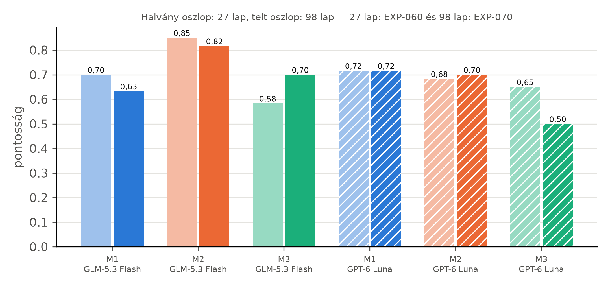
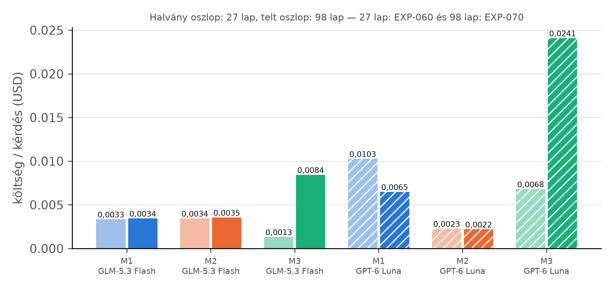

# Kiértékelés

Ebben a fejezetben a három módszert két nagy üzemen mérjük meg: egy 27 lapos és egy 98 lapos
üzemen. A módszereket a négylapos kis üzemen fejlesztettük és fagyasztottuk be, a nagy üzemeken
semmit nem változtattunk rajtuk, így a nagy üzemek mind a 60-60 kérdése tesztkérdés. Minden szám a
megadott mérésből származik (`docs/eredmenyek.md`).

## Beállítás

Mindhárom módszert mindkét kérdés-válaszoló modellel futtattuk: `z-ai/glm-5.3-flash` és
`openai/gpt-6-luna`, OpenRouteren át, Benedek rögzített paramétereivel. A Luna-pinek Benedek
pin-fájljai, a GLM-hez az ő `pin_low` beállítását és annak magas gondolkodású változatát
használtuk. Minden hívás cache-elt és naplózott; a teljes projekt fizetős költése 6,8879 USD volt
a 20 USD-s keretből (EXP-068), ebből a 27 lapos üzem mérése 1,8411 USD (EXP-063), a 98 lapos üzemé
3,4126 USD (EXP-068). A pontosság a helyes válaszok aránya; a konfidenciaintervallum 10 000
ismétléses, seedelt percentilis-bootstrap, a módszerpárok különbségét ugyanazokon a kérdéseken,
párosítva számoltuk.

## A fejlesztés a kis üzemen

A kis üzem 20 kérdéses fejlesztési halmazán négy iterációt mértünk (EXP-010–EXP-013). Ezek
hozták az M1 Cypher-szintjének lekérdezési szabályait, az M2 és az M3 válaszszabályát (részválasznál
a meglévő és a hiányzó rész megnevezése, a dokumentumon túli tanács tilalma) és a Rosemount 3051
adatlapgráfját; utána a módszereket befagyasztottuk. A kis üzem befagyasztott, 40 kérdéses
teszthalmazán a legjobb az M2 volt GLM-mel (31 helyes), a gráf nélküli M3 30, az M1 25 helyes
választ adott (EXP-020). A kis üzem méréseit a Függelék G írja le részletesen; a továbbiakban csak
a két nagy üzemmel foglalkozunk.

## Eredmény a két nagy üzemen

Mindkét nagy üzem 60 kérdése (családonként 15) mindegyik párosításon egyszer futott le (27 lap:
EXP-060, 98 lap: EXP-070). Az eredményt az alábbi táblázat és ábra mutatja.

Táblázat: Eredmény a két nagy üzemen párosításonként és családonként (60-60 kérdés; 27 lap: EXP-060, 98 lap: EXP-070)
| Módszer | Modell | Lap | Helyes | Részben | Rossz | Halluc. | Pontosság [95% CI] | (a) | (b) | (c) | (d) |
|---|---|---|---|---|---|---|---|---|---|---|---|
| M1 | GLM-5.3 Flash | 27 | 42 | 9 | 8 | 1 | 0,700 [0,583–0,817] | 12 | 11 | 7 | 12 |
| M1 | GLM-5.3 Flash | 98 | 38 | 11 | 10 | 1 | 0,633 [0,517–0,750] | 12 | 6 | 9 | 11 |
| M2 | GLM-5.3 Flash | 27 | 51 | 4 | 5 | 0 | 0,850 [0,750–0,933] | 13 | 13 | 11 | 14 |
| M2 | GLM-5.3 Flash | 98 | 49 | 4 | 7 | 0 | 0,817 [0,717–0,917] | 12 | 13 | 11 | 13 |
| M3 | GLM-5.3 Flash | 27 | 35 | 5 | 20 | 0 | 0,583 [0,450–0,700] | 6 | 6 | 8 | 15 |
| M3 | GLM-5.3 Flash | 98 | 42 | 4 | 14 | 0 | 0,700 [0,583–0,817] | 11 | 8 | 9 | 14 |
| M1 | GPT-6 Luna | 27 | 43 | 12 | 5 | 0 | 0,717 [0,600–0,833] | 14 | 7 | 8 | 14 |
| M1 | GPT-6 Luna | 98 | 43 | 13 | 4 | 0 | 0,717 [0,600–0,833] | 14 | 6 | 9 | 14 |
| M2 | GPT-6 Luna | 27 | 41 | 14 | 4 | 1 | 0,683 [0,567–0,800] | 11 | 8 | 8 | 14 |
| M2 | GPT-6 Luna | 98 | 42 | 12 | 6 | 0 | 0,700 [0,583–0,817] | 12 | 8 | 8 | 14 |
| M3 | GPT-6 Luna | 27 | 39 | 7 | 14 | 0 | 0,650 [0,533–0,767] | 12 | 5 | 9 | 13 |
| M3 | GPT-6 Luna | 98 | 30 | 10 | 20 | 0 | 0,500 [0,383–0,633] | 8 | 4 | 7 | 11 |

Mindkét méretnél az M2 a legjobb párosítás GLM-mel: 51, illetve 49 helyes válasz a 60-ból. A 27
lapos üzemen GLM-mel az M2 szignifikánsan jobb a gráf nélküli M3-nál (párosított különbség
+0,267, 95% CI +0,133 és +0,400 között) és az M1-nél (az M1 és az M2 különbsége −0,150; −0,267 és
−0,033 között); Lunával ott egyik különbség sem szignifikáns (EXP-060). A 98 lapos üzemen GLM-mel
az M2 szignifikánsan jobb az M1-nél (−0,183; −0,317 és −0,050 között), az M3-nál pedig a határon
(+0,117; 0,000 és +0,233 között); Lunával mindkét gráfos módszer szignifikánsan jobb az M3-nál (az
M1-é +0,217, 95% CI +0,100 és +0,333 között, az M2-é +0,200, +0,050 és +0,350 között; EXP-070). A
gráfos módszerek pontossága a két méret között alig változott (az M2 GLM-mel 51-ről 49-re, Lunával
41-ről 42-re, az M1 Lunával 43 maradt), a gráf nélküli M3-é viszont modellenként ellentétes
irányba mozdult: GLM-mel 35-ről 42-re nőtt, Lunával 39-ről 30-ra esett. A 720 válaszból három
hallucinált.

## A gráf szerepe a nagy rajzon

Az M3 a teljes szerializált rajzot és tizenkét adatlap-darabot kapja promptban, a gráfos módszerek
viszont a rajzot lekérdezéssel vagy gráfbejáró eszközzel olvassák, és a modell csak a talált
elemeket látja. Ennek két következménye látszik. Az első a megbízhatóság: a 27 lapos üzemen az M3
GLM-mel a rajzi kérdések közül csak 6-ot oldott meg a 15-ből, és a 9 nem helyes válaszból 8 téves
„nincs benne” jelzés volt; a kis üzemen egyetlen ilyen eset sem fordult elő (EXP-062). A 98 lapos
üzemen ugyanez a párosítás 11 rajzi kérdést oldott meg, téves „nincs benne” nélkül, a Luna viszont
12-ről 8-ra esett (EXP-067). A gráf nélküli módszer viselkedése tehát a rajz méretével
kiszámíthatatlanul változik, a gráfos módszereké stabil. A második következmény a költség (lásd
alább). Mindkettő egybevág Benedek mérésével, amely szerint a teljes rajz promptba tétele a
lapszámmal romlik és drágul (2. fejezet).

## Költség és késleltetés

Táblázat: Költség és medián késleltetés kérdésenként a két nagy üzemen (27 lap: EXP-060, 98 lap: EXP-070)
| Módszer | Modell | Költség / kérdés, 27 lap (USD) | Költség / kérdés, 98 lap (USD) | Medián késleltetés, 27 lap (s) | Medián késleltetés, 98 lap (s) |
|---|---|---|---|---|---|
| M1 | GLM-5.3 Flash | 0,00335 | 0,00345 | 17,9 | 18,0 |
| M2 | GLM-5.3 Flash | 0,00344 | 0,00355 | 12,4 | 15,4 |
| M3 | GLM-5.3 Flash | 0,00133 | 0,00844 | 15,9 | 3,2 |
| M1 | GPT-6 Luna | 0,01027 | 0,00649 | 14,7 | 14,5 |
| M2 | GPT-6 Luna | 0,00227 | 0,00220 | 16,9 | 15,7 |
| M3 | GPT-6 Luna | 0,00680 | 0,02409 | 6,4 | 6,5 |

A gráfos módszerek kérdésenkénti költsége a 27 és a 98 lap között gyakorlatilag nem változott (az
M2 GLM-mel 0,00344 és 0,00355 USD, Lunával 0,00227 és 0,00220 USD), mert a modellhez mindig csak a
lekérdezés eredménye jut el. Az M3 költsége a rajz méretével nőtt: GLM-mel 0,00133-ról 0,00844
USD-re, Lunával 0,00680-ról 0,02409 USD-re (EXP-060, EXP-070). A 98 lapos üzemen így a gráf nélküli
módszer Lunával több mint tízszer drágább kérdésenként, mint az M2, és kevesebb helyes választ ad. Az M1
Lunával a 98 lapos üzemen olcsóbb volt, mert több kérdést zárt le már a Cypher-szinten (lásd az
útvonalakat). Az M3 GLM-mel mért 3,2 s-os medián késleltetésének okát nem vizsgáltuk.

## Útvonalak

Az M1 GLM-mel a 27 lapos üzemen a 60 kérdésből 32-t a Cypher-szinten zárt le, 8-hoz az ágens is
kellett adatlap-hívás nélkül, 20-hoz az ágens és legalább egy `datasheet_fact` hívás; a 98 lapos
üzemen ugyanez 29, 10 és 21. Lunával 35, 5 és 20, illetve 40, 7 és 13. Az M2 mindkét méretnél
nagyjából harmadolta a kérdéseket a csak rajzi, a csak adatlapi és a mindkét eszközt hívó útvonal
között (GLM-mel 20, 20, 20 és 20, 21, 19; Lunával 20, 21, 19 és 22, 19, 19; EXP-060, EXP-070), ami a
kérdéscsaládok megoszlásával egyezik.

## Több adatlapos kérdések

Mindkét nagy üzemen lefuttattuk a 12 kérdéses (e) családot is, amelyben a rajzon egy utat, egy
elemhalmazt vagy két topológiai lépést kell bejárni, és két-három különböző adatlapot kell
összevetni (például „Along the process flow path from E-1-1 to CHV-2-1, which item has the lowest
maximum allowable pressure according to its datasheet?”). A referenciát program rakta össze a gold
gráfból és a PDF-ekből gyűjtött tényekből (EXP-008, EXP-052, EXP-065).

Táblázat: A több adatlapos kérdések eredménye a két nagy üzemen (12-12 kérdés; 27 lap: EXP-061, 98 lap: EXP-071)
| Módszer | Modell | Helyes, 27 lap | Részben, 27 lap | Helyes, 98 lap | Részben, 98 lap |
|---|---|---|---|---|---|
| M1 | GLM-5.3 Flash | 6 | 2 | 2 | 2 |
| M2 | GLM-5.3 Flash | 5 | 3 | 6 | 2 |
| M3 | GLM-5.3 Flash | 0 | 0 | 0 | 3 |
| M1 | GPT-6 Luna | 6 | 3 | 3 | 4 |
| M2 | GPT-6 Luna | 6 | 2 | 1 | 4 |
| M3 | GPT-6 Luna | 0 | 0 | 0 | 2 |

A 27 lapos üzemen a két gráfos módszer a kérdések felénél (5–6 kérdés a 12-ből) adott teljesen
helyes választ, a gráf nélküli M3 egyetlen kérdésnél sem; az M1 és az M3 különbsége mindkét
modellel +0,5 (95% CI +0,25 és +0,75 között), szignifikánsan (EXP-061). A 98 lapos üzemen ezek a
kérdések minden párosításnak nehezebbek lettek: teljesen helyes választ csak az M2 GLM-mel adott
nagyobb számban (6 kérdés), szignifikánsan többet, mint az M3 (+0,5; +0,25 és +0,75 között); a többi
párosítás 0–3 kérdést oldott meg (EXP-071). A hosszabb utakon és nagyobb elemhalmazokon több
elemet kell bejárni és több adatlapot lekérdezni, és a lépés- és időkorlát itt hamarabb elfogy:
az M2 mindkét modellel 3-3 kérdésnél üres választ adott mindkét méretnél (EXP-062, EXP-067).

## Hibaelemzés

**Téves „nincs benne” válaszok.** A gráf nélküli módszer egyik jellemző hibája a hamis lemondás:
az M3 GLM-mel a 27 lapos üzemen a rajzi kérdéseknél 8, a több adatlapos kérdéseknél 9 esetben
állította, hogy a dokumentum nem tartalmazza a választ; a 98 lapos üzemen a rajzi kérdéseknél
egyszer sem, a több adatlapos kérdéseknél 7 esetben (EXP-062, EXP-067). Ez veszélyesebb, mint
amilyennek látszik, mert a „nincs benne” a megválaszolhatatlan kérdéseken helyes, így a (d)
családon az M3 jól szerepel, miközben a megválaszolható kérdéseken elbukik.

**Az M1 egyetlen lekérdezése.** Az M1 hibáinak nagy része „részben helyes” válasz: a Cypher-szint
egy szűk lekérdezéssel talál egy releváns adatpontot, a kaszkád elfogadja a nem üres eredményt,
és a válaszból kimarad egy feltétel vagy egy második érték. A 27 lapos üzemen például a 2
hüvelykes szabályozószelep teljesen nyitott Cv-értékére az M1 a változatok értékeit sorolta fel a
referenciában szereplő feltétel (teljes méretű trim, egyenlő százalékos kosár, normál
átfolyási irány) nélkül. Az elfogadási szabály a rajzi kérdésekre készült, ahol a nem üres
sorhalmaz jó jelzés; adatlapi kérdésnél a hiányos sor is nem üres.

**Az M2 eszközhívásai.** Az M2 a rajzeszköznek szabad szöveges kérdést ad, ezért a válasz alakja
elcsúszhat (a kis üzemen például szabályozókör helyett a szelepét adta meg, Függelék G), és a
több adatlapos kérdéseknél néhányszor üres választ adott, mielőtt minden elem adatlapját
lekérdezte volna (EXP-062, EXP-067).

**A referencia és a bírálat korlátja.** A (b)–(d) család referenciaválaszait egy modell írta a
PDF-ből, és ember nem ellenőrizte őket; a bíráló ugyanazt a referenciát látta minden módszernél,
ezért az összevetés igazságos, de az abszolút számok a referencia hibáival együtt értendők. A
bírálók között egy következetlenséget is láttunk: egy óvatoskodó válaszfajtát az egyik
„részben helyes”, a másik „helyes” ítélettel pontozott. Az ítéleteket nem írtuk felül.
