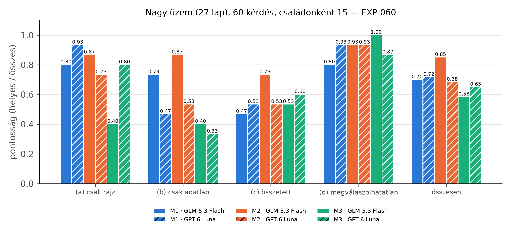

# Kiértékelés

Ebben a fejezetben a három módszert a 27 lapos nagy üzemen mérjük meg. A módszereket a négylapos
kis üzemen fejlesztettük és fagyasztottuk be, a nagy üzemen semmit nem változtattunk rajtuk, így
a nagy üzem mind a 60 kérdése tesztkérdés. Minden szám a megadott mérésből származik
(`docs/eredmenyek.md`).

## Beállítás

Mindhárom módszert mindkét kérdés-válaszoló modellel futtattuk: `z-ai/glm-5.3-flash` és
`openai/gpt-6-luna`, OpenRouteren át, Benedek rögzített paramétereivel. A Luna-pinek Benedek
pin-fájljai, a GLM-hez az ő `pin_low` beállítását és annak magas gondolkodású változatát
használtuk. Minden hívás cache-elt és naplózott; a teljes projekt fizetős költése 3,4753 USD volt
a 20 USD-s keretből, ebből a nagy üzem mérése 1,8411 USD (EXP-063). A pontosság a helyes
válaszok aránya; a konfidenciaintervallum 10 000 ismétléses, seedelt percentilis-bootstrap, a
módszerpárok különbségét ugyanazokon a kérdéseken, párosítva számoltuk.

## A fejlesztés a kis üzemen

A kis üzem 20 kérdéses fejlesztési halmazán négy iterációt mértünk (EXP-010–EXP-013). Ezek
hozták az M1 Cypher-szintjének lekérdezési szabályait, az M2 és az M3 válaszszabályát (részválasznál
a meglévő és a hiányzó rész megnevezése, a dokumentumon túli tanács tilalma) és a Rosemount 3051
adatlapgráfját; utána a módszereket befagyasztottuk. A kis üzem befagyasztott, 40 kérdéses
teszthalmazán a legjobb az M2 volt GLM-mel (31 helyes), a gráf nélküli M3 30, az M1 25 helyes
választ adott (EXP-020). A kis üzem méréseit a Függelék G írja le részletesen; a továbbiakban csak
a nagy üzemmel foglalkozunk.

## Eredmény a nagy üzemen

A nagy üzem 60 kérdése (családonként 15) mindegyik párosításon egyszer futott le (EXP-060). Az
eredményt az alábbi táblázat és ábra mutatja.

Táblázat: Eredmény a nagy üzemen párosításonként és családonként (60 kérdés, EXP-060)
| Módszer | Modell | Helyes | Részben | Rossz | Hallucinált | Pontosság [95% CI] | (a) | (b) | (c) | (d) |
|---|---|---|---|---|---|---|---|---|---|---|
| M1 | GLM-5.3 Flash | 42 | 9 | 8 | 1 | 0,700 [0,583–0,817] | 12/15 | 11/15 | 7/15 | 12/15 |
| M2 | GLM-5.3 Flash | 51 | 4 | 5 | 0 | 0,850 [0,750–0,933] | 13/15 | 13/15 | 11/15 | 14/15 |
| M3 | GLM-5.3 Flash | 35 | 5 | 20 | 0 | 0,583 [0,450–0,700] | 6/15 | 6/15 | 8/15 | 15/15 |
| M1 | GPT-6 Luna | 43 | 12 | 5 | 0 | 0,717 [0,600–0,833] | 14/15 | 7/15 | 8/15 | 14/15 |
| M2 | GPT-6 Luna | 41 | 14 | 4 | 1 | 0,683 [0,567–0,800] | 11/15 | 8/15 | 8/15 | 14/15 |
| M3 | GPT-6 Luna | 39 | 7 | 14 | 0 | 0,650 [0,533–0,767] | 12/15 | 5/15 | 9/15 | 13/15 |

A legjobb párosítás az M2 GLM-mel (51 helyes a 60-ból). GLM-mel az M2 szignifikánsan jobb a gráf
nélküli M3-nál (párosított különbség +0,267, 95% CI +0,133 és +0,400 között) és az M1-nél (az M1
és az M2 különbsége −0,150; −0,267 és −0,033 között); az M1 és az M3 különbsége (+0,117; −0,033 és
+0,267 között) nem szignifikáns. Lunával a három módszer különbsége nem szignifikáns. A 360
válaszból kettő hallucinált (az M1 GLM-mel és az M2 Lunával egy-egy). A rajzi (a) családon a két
gráfos módszer 11–14 helyes választ adott a 15-ből; az adatlapi (b) és az összetett (c) családon
az M2 GLM-mel 13, illetve 11 kérdést oldott meg, a gráf nélküli M3 legfeljebb 6, illetve 9-et.

## A gráf szerepe a nagy rajzon

Az M3 a teljes szerializált rajzot és tizenkét adatlap-darabot kapja promptban. A kis üzemen ez
versenyképes volt, a nagy üzemen GLM-mel a rajzi kérdések közül csak 6-ot oldott meg a 15-ből. A
9 nem helyes válaszból 8 téves „nincs benne” jelzés: a modell a 27 lapos rajz szövegében nem
találta meg a választ, és úgy döntött, hogy a dokumentum nem tartalmazza; a kis üzemen egyetlen
ilyen eset sem fordult elő (EXP-062). Ugyanez a hiba a több adatlapos kérdéseken is megjelenik
(lásd alább). A gráfos módszereknél ez a hiba nem jelentkezik, mert ott a rajzot lekérdezés vagy
gráfbejáró eszköz olvassa, és a modell csak a talált elemeket látja. Ez egybevág Benedek
mérésével, amely szerint a teljes rajz promptba tétele a lapszámmal romlik és drágul (2. fejezet).

## Költség és késleltetés

Táblázat: Költség és medián késleltetés kérdésenként a nagy üzemen (EXP-060)
| Módszer | Modell | Költség / kérdés (USD) | Medián késleltetés (s) |
|---|---|---|---|
| M1 | GLM-5.3 Flash | 0,00335 | 17,9 |
| M2 | GLM-5.3 Flash | 0,00344 | 12,4 |
| M3 | GLM-5.3 Flash | 0,00133 | 15,9 |
| M1 | GPT-6 Luna | 0,01027 | 14,7 |
| M2 | GPT-6 Luna | 0,00227 | 16,9 |
| M3 | GPT-6 Luna | 0,00680 | 6,4 |

Kérdésenként egyik módszer sem drágább egy amerikai centnél a GPT-6 Luna M1-es párosításán kívül
(0,01027 USD). Az M1 első szintje a teljes kétrétegű sémát és a 164 adatlappal rendelkező tag
listáját kapja promptban, és ha a válaszát nem fogadják el, az ágens is lefut. Az M2 csak a
szükséges eszközt hívja. Az M3 kérdésenként egyetlen hívás, de a 27 lapos rajzot is viszi
magával; a kis üzemhez képest a kérdésenkénti költsége GLM-mel 0,00029-ről 0,00133 USD-re,
Lunával 0,00182-ről 0,00680 USD-re nőtt (EXP-020, EXP-060), és a nagyobb rajzzal tovább nőne.

## Útvonalak

Az M1 GLM-mel a 60 kérdésből 32-t a Cypher-szinten zárt le, 8-hoz az ágens is kellett
adatlap-hívás nélkül, 20-hoz az ágens és legalább egy `datasheet_fact` hívás; Lunával ugyanez 35,
5 és 20. Az M2 GLM-mel 20 kérdésnél csak a rajzot, 20-nál csak az adatlapot, 20-nál mindkettőt
kérdezte; Lunával 20, 21 és 19 (EXP-060). Az M2 tehát a kérdések kétharmadánál a két forrás
közül csak az egyiket hívja, és ez a kérdéscsaládok megoszlásával egyezik.

## Több adatlapos kérdések

A nagy üzemen is lefuttattuk a 12 kérdéses (e) családot, amelyben a rajzon egy utat, egy
elemhalmazt vagy két topológiai lépést kell bejárni, és két-három különböző adatlapot kell
összevetni (például „Along the process flow path from E-1-1 to CHV-2-1, which item has the lowest
maximum allowable pressure according to its datasheet?”). A referenciát program rakta össze a gold
gráfból és a PDF-ekből gyűjtött tényekből (EXP-008, EXP-052).

Táblázat: A több adatlapos kérdések eredménye a nagy üzemen (12 kérdés, EXP-061)
| Módszer | Modell | Helyes | Részben | Rossz | Hallucinált | Költség / 12 kérdés (USD) | Medián késleltetés (s) |
|---|---|---|---|---|---|---|---|
| M1 | GLM-5.3 Flash | 6 | 2 | 4 | 0 | 0,0371 | 18,2 |
| M2 | GLM-5.3 Flash | 5 | 3 | 3 | 1 | 0,0568 | 23,9 |
| M3 | GLM-5.3 Flash | 0 | 0 | 12 | 0 | 0,0127 | 21,0 |
| M1 | GPT-6 Luna | 6 | 3 | 3 | 0 | 0,1640 | 33,4 |
| M2 | GPT-6 Luna | 6 | 2 | 4 | 0 | 0,0875 | 38,1 |
| M3 | GPT-6 Luna | 0 | 0 | 12 | 0 | 0,0907 | 18,4 |

A két gráfos módszer a kérdések felénél (5–6 kérdés a 12-ből) adott teljesen helyes választ, a
gráf nélküli M3 egyetlen kérdésnél sem; az M1 és az M3 különbsége mindkét modellel +0,5 (95% CI
+0,25 és +0,75 között), az M2-é GLM-mel +0,417, Lunával +0,5, szintén szignifikánsan
(EXP-061). Az M3 GLM-mel 9 kérdésnél téves „nincs benne” választ adott, Lunával mind a 12
válasza rossz tartalmú volt; az M2 mindkét modellel 3-3 kérdésnél üres választ adott (lépéskorlát
vagy feldolgozási hiba, EXP-062). A több elem bejárását és az elemenkénti adatlap-lekérdezést
a gráfos módszerek eszközhívásai természetesen leképezik, az egyetlen prompt viszont nem.

## Hibaelemzés

**A gráf nélküli módszer téves „nincs benne” válaszai.** A nagy rajzon a fő hiba nem a rossz
érték, hanem a hamis lemondás: az M3 GLM-mel a rajzi kérdéseknél 8, a több adatlapos kérdéseknél
9 esetben állította, hogy a dokumentum nem tartalmazza a választ (EXP-062). Ez veszélyesebb, mint
amilyennek látszik, mert a „nincs benne” a megválaszolhatatlan kérdéseken helyes, így a (d)
családon az M3 GLM-mel hibátlan (15/15), miközben a megválaszolható kérdéseken elbukik.

**Az M1 egyetlen lekérdezése.** Az M1 hibáinak nagy része „részben helyes” válasz: a Cypher-szint
egy szűk lekérdezéssel talál egy releváns adatpontot, a kaszkád elfogadja a nem üres eredményt,
és a válaszból kimarad egy feltétel vagy egy második érték. A nagy üzemen például a 2 hüvelykes
szabályozószelep teljesen nyitott Cv-értékére az M1 a változatok értékeit sorolta fel a
referenciában szereplő feltétel (teljes méretű trim, egyenlő százalékos kosár, normál
átfolyási irány) nélkül. Az elfogadási szabály a rajzi kérdésekre készült, ahol a nem üres
sorhalmaz jó jelzés; adatlapi kérdésnél a hiányos sor is nem üres.

**Az M2 eszközhívásai.** Az M2 a rajzeszköznek szabad szöveges kérdést ad, ezért a válasz alakja
elcsúszhat (a kis üzemen például szabályozókör helyett a szelepét adta meg, Függelék G), és a
több adatlapos kérdéseknél néhányszor üres választ adott, mielőtt minden elem adatlapját
lekérdezte volna (EXP-062).

**A referencia és a bírálat korlátja.** A (b)–(d) család referenciaválaszait egy modell írta a
PDF-ből, és ember nem ellenőrizte őket; a bíráló ugyanazt a referenciát látta minden módszernél,
ezért az összevetés igazságos, de az abszolút számok a referencia hibáival együtt értendők. A
három bíráló között egy következetlenséget is láttunk: egy óvatoskodó válaszfajtát az egyik
„részben helyes”, a másik „helyes” ítélettel pontozott. Az ítéleteket nem írtuk felül.
