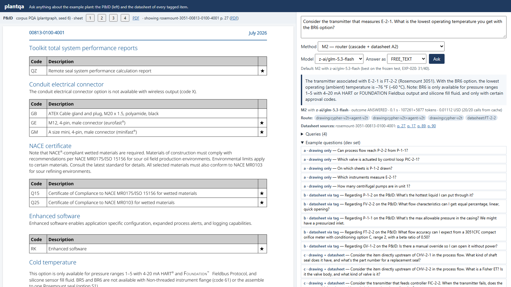
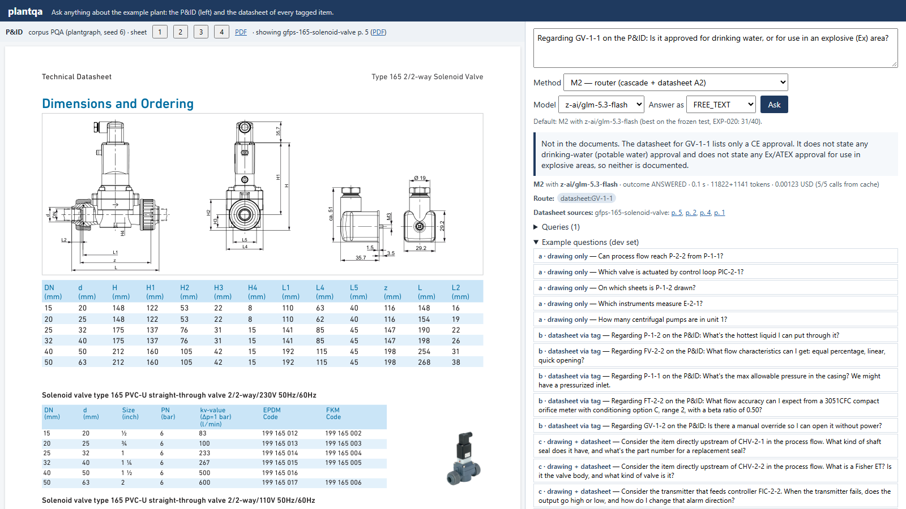

# Demó és esettanulmány

A mért számok azt mutatják meg, milyen gyakran helyes egy módszer, azt nem, hogyan jut el a
válaszig. Ebben a fejezetben bemutatjuk a webes demót, amelyben a három módszer kipróbálható, majd
két képernyőképen végigkövetünk két kérdést; a próba további négy kérdését a Függelék F
mutatja be. A képek a demó próbáján készültek: hat
kérdést tettünk fel a futó demón, az (a), (a), (b), (c), (d) és (e) családból, az M1, M2 és M3
módszerrel, GLM-mel; mind a hat kérdésre érdemi válasz jött. A próba nem pontossági mérés, a
válaszokat nem pontoztuk.

## A demó felépítése

A demó egy helyi webalkalmazás: egy webszerver és egyetlen
weboldal. A szerver ugyanazokat a módszerobjektumokat építi fel, amelyeket a mérés használ (az
első kérdésnél, utána újrahasznosítja őket), így a demó válaszai pontosan azon az úton születnek,
amelyet az 5. fejezetben leírtunk. A korábban feltett kérdésekre a demó a már eltárolt válaszokkal
is tud felelni, új, fizetős modellhívás nélkül.

Az oldal két részre oszlik.

- **Bal oldal: a dokumentum.** Alapállapotban a P&ID látszik, a generátor rajzexportjából: a fejléc
  megnevezi a korpuszt (a plantgraph 6-os seedű üzeme), és lapváltó gombokkal a négy lap
  között lehet lépkedni; a teljes rajz PDF-ben is megnyitható. Ha a felhasználó egy válasz
  adatlapi forrásoldalára kattint, a bal oldalon az adatlap adott oldala jelenik meg képként, a
  fejlécben a dokumentum azonosítójával és oldalszámával, valamint egy hivatkozással, amely a PDF-et
  ennél az oldalnál nyitja meg.
- **Jobb oldal: a kérdés és a válasz.** Egy szövegmezőbe kerül a kérdés; alatta választható a
  módszer (M1, M2 vagy M3, egy rövid leírással), a modell (GLM-5.3 Flash vagy
  GPT-6 Luna) és a válaszalak (az 5. fejezetben felsorolt alakok közül). Az alapértelmezés
  az M2 GLM-mel, mert ez a párosítás volt a legjobb a kis üzem tesztjén (31 helyes a
  40-ből; ezt az oldal ki is írja) és a 100 lapos tesztüzemen is (51 helyes a 60-ból). A
  demó a kis üzemen fut, mert annak négy lapja a képernyőn jól áttekinthető.

A válasz alatt a demó megmutatja a válasz nyomait: a módszert, a modellt, a kimenetelt, a
késleltetést, a tokenszámot, a költséget és a gyorsítótárból jött hívások számát. Ezután
következik az útvonal címkék sorozataként (az M1-nél a lefutott szintek és az adatlapi hívások, az
M2-nél az irányító eszközhívásai, az M3-nál a kontextus fajtája), az adatlapi forrásoldalak
kattintható oldalszámként, és egy lenyitható blokkban a lefutott lekérdezések. Végül a fejlesztési halmaz
kérdései szerepelnek példaként, családonként csoportosítva. A teszthalmaz kérdései nincsenek a
példák között.

A képernyőképeket egy program készítette: minden kérdést előbb az API-n tett fel, majd fej
nélküli böngészővel lefényképezte az oldalt. Ezért a képeken látható késleltetés a gyorsítótárból
kiszolgált válaszé; a valódi késleltetést a 6. fejezet adja.

## Két kérdés végigkövetve

### Összetett kérdés az irányítóval

Az első kérdés az összetett (c) családból való: „Consider the transmitter that measures E-2-1.
What is the lowest operating temperature you get with the BR6 option?” A kérdés a hőcserélőt
nevezi meg, a választ viszont a hőcserélőt mérő távadó adatlapja tartalmazza, és ott is csak egy
rendelési opcióhoz kötve. A kérdés tehát egy topológiai lépést (melyik műszer méri az E-2-1-et?)
és egy feltételes adatlapi tényt (a legalacsonyabb hőmérséklet a BR6 opcióval) kapcsol össze.

Az M2 útvonala: az irányító háromszor kérdezte a rajzeszközt, ebből kétszer a kaszkád az
első szintről az ágensig jutott, egyszer már az első szinten zárult; ezután az FT-2-2 adatlapját
kérdezte. A válasz így kezdődik: „The transmitter associated with E-2-1 is FT-2-2 (Rosemount
3051).” Ezután megadja a BR6 opcióval elérhető legalacsonyabb környezeti hőmérsékletet Fahrenheit-
és Celsius-fokban, és hozzáteszi, hogy a BR6 csak bizonyos nyomástartományokkal, kimenettel és
töltőfolyadékkal rendelhető. Ez a plantdocs válaszírójának szabálya: egy érték a feltételei nélkül
hibás lehet. A bal oldalon az adatlap azon oldala látszik, amely a hideg
környezetre vonatkozó opció feltételeit írja le. Az irányító tehát a tag-et a rajzból szerzi meg, és
az adatlapi kérdést már a tag-re teszi fel, ahogy a rendszerüzenete előírja; a rajzeszköz
ismételt hívása viszont a késleltetést növeli.

### Megválaszolhatatlan kérdés és a részletes „nincs benne”

A második kérdés a (d) családból való, amelynek kérdéseire a dokumentumok nem adnak választ:
„Regarding GV-1-1 on the P&ID: Is it approved for drinking water, or for use in an explosive (Ex)
area?” A kérdés tag-et nevez meg, ezért az M2 irányítója a rajzeszköz nélkül, közvetlenül a GV-1-1
adatlapját kérdezte (csak az adatlap-eszközt hívta, a GV-1-1 tag-re).

A válasz „nincs benne” jelzésű, de nem áll meg ennyinél: „Not in the documents. The datasheet for
GV-1-1 lists only a CE approval. It does not state any drinking-water (potable water) approval and
does not state any Ex/ATEX approval…”. A felhasználó így azt is megtudja, mit tartalmaz
az adatlap a tanúsításokról, és ellenőrizheti a forrásoldalon. Ez a megjelenítés egy hibajavítás
eredménye, amelyet a demó egy korábbi próbája derített ki: a válasz megjelenítése és a bírálónak
exportált jelölt szöveg a „nincs benne” jelzésnél eredetileg csak a jelzést mutatta, és elnyelte a
mellette írt magyarázatot. A hibát kijavítottuk, az érintett fejlesztési tételeket a javított szöveggel
újrabíráltattuk, és a végső teszt exportja már a javított kóddal készült. A
demó tehát nemcsak bemutató, hanem ellenőrző eszköz is volt: olyan hibát talált meg, amely a
pontozást is érintette.

## Tanulságok

A demó azt mutatja meg, amit a pontossági számok nem: az útvonal és a lekérdezések láthatók, így
egy rossz válasz gyorsan felismerhető, és a forrásoldal egy kattintással a rajz helyén jelenik meg.

A demó korlátai: egy új kérdés élő LLM-hívásokba kerül, és másodpercekig tart (a gyorsítótár
csak az ismétlést teszi ingyenessé); a demó egyetlen üzemet ismer, mert egy másik üzemhez a teljes
összevont betöltést újra kellene futtatni; és angol nyelvű, mint a kérdéssor és a két
forrásrendszer promptjai. A demóval és a mérésekkel együtt minden elem a helyén van ahhoz, hogy
a következő fejezetben válaszoljunk a kutatási kérdésekre.
