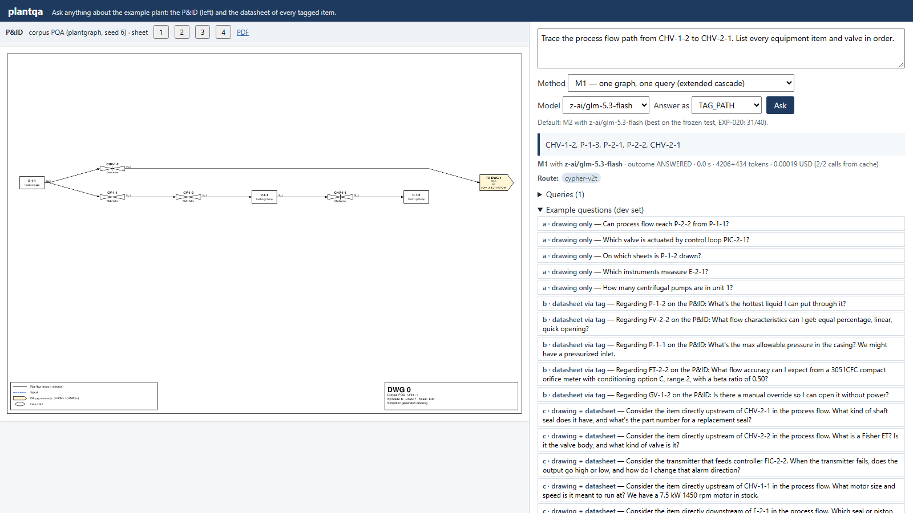
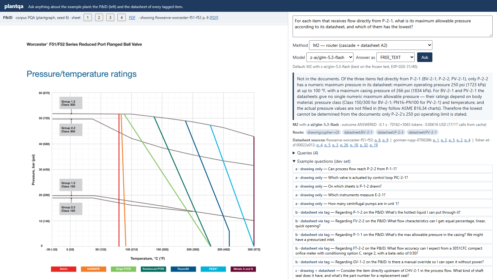
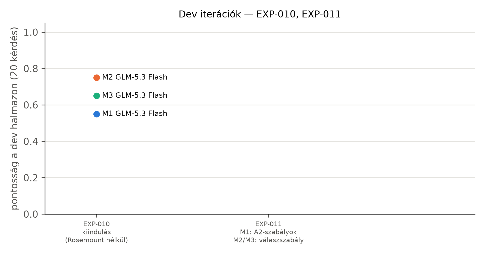
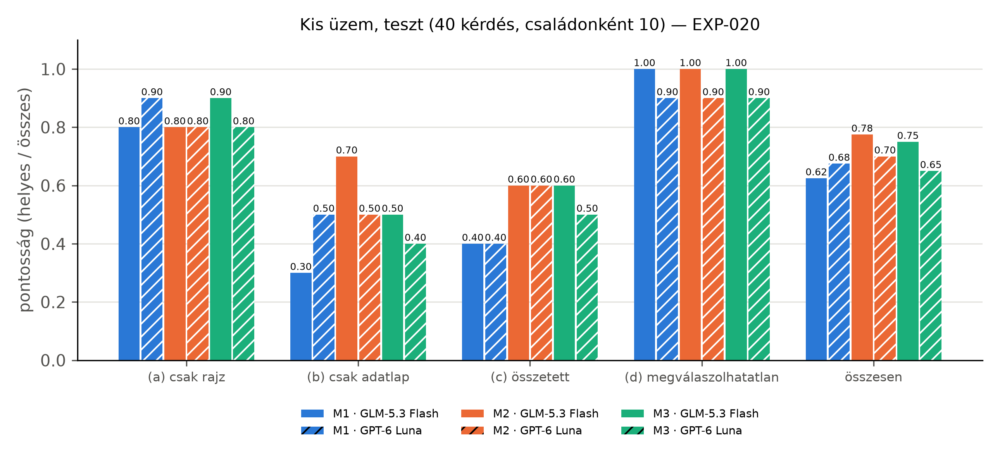
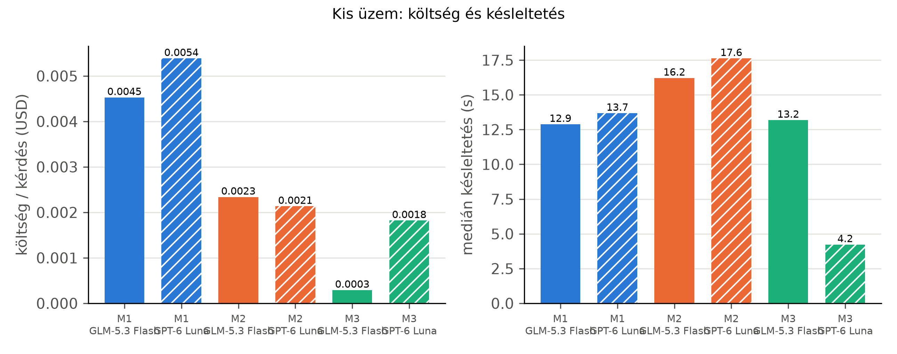
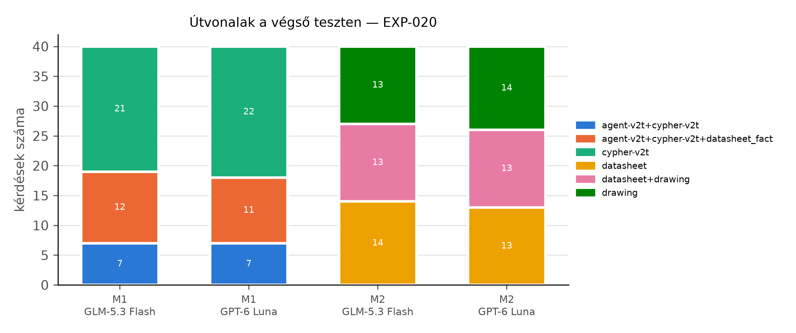

# Függelék

## A. Példakérdések családonként (dev halmaz)

Táblázat: Két példakérdés családonként a dev halmazból, a referenciaválasz rövidítve (EXP-004)
| Család | Kérdés | Referenciaválasz (rövidítve) |
|---|---|---|
| (a) | Can process flow reach P-2-2 from P-1-1? | no |
| (a) | Which valve is actuated by control loop PIC-2-1? | PV-2-1 |
| (b) | Regarding P-1-2 on the P&ID: What's the hottest liquid I can put through it? | 160 °F (71 °C) maximum liquid temperature (seal limit); the 250 psi max operating pressure applies only up to 100 °F (37 °C); consult the factory beyond. |
| (b) | Regarding FV-2-2 on the P&ID: What flow characteristics can I get: equal percentage, linear, quick opening? | Standard cages: quick-opening, linear or equal percentage. Whisper Trim, WhisperFlo and Cavitrol cages: linear only. |
| (c) | Consider the item directly upstream of CHV-2-1 in the process flow. What kind of shaft seal does it have, and what's the part number for a replacement seal? | Mechanical, self-lubricated seal: silicon carbide rotating and stationary faces, fluorocarbon (Viton or equivalent) elastomers, 316 stainless shaft sleeve and s |
| (c) | Consider the item directly upstream of CHV-2-2 in the process flow. What is a Fisher ET? Is it the valve body, and what kind of valve is it? | A sliding-stem, single-port globe-style control valve (body) with cage guiding, balanced valve plug and push-down-to-close plug action, for throttling or on-off |
| (d) | Regarding GV-1-2 on the P&ID: It hums but won't open. What could be wrong? | No troubleshooting in the datasheet. Related facts only: it needs at least 0.5 bar differential pressure to open; voltage must match the type plate (±10 %). The |
| (d) | Regarding PV-2-1 on the P&ID: The valve leaks through when shut. Is it the seat ring or the plug seal, and how do I check? | Not in the document (no troubleshooting). |

## B. Az M2 router rendszerüzenete

```
You answer questions about one industrial plant. You cannot see the documents
yourself; you have two tools:
- drawing(question): answers a question about the plant's P&ID drawing (which items exist and
  their tags and types, what is connected to what, flow paths, upstream/downstream items,
  which instrument measures what, control loops, units, sheets).
- datasheet(tag, question): answers a question about the vendor datasheet of the item with
  this tag (its specification: pressures, temperatures, materials, sizes, options, ...).
  Items with a datasheet: <24 tags>.
If a question names an item by its position or role (e.g. "the valve downstream of P-1-1"),
first ask the drawing tool for its tag, then ask the datasheet tool about that tag.
Each turn, reply with exactly one JSON object and nothing else:
{"tool": "drawing", "question": "..."}
{"tool": "datasheet", "tag": "...", "question": "..."}
{"final": {"answer": <answer or null>, "not_present": <true if the documents do not contain
the answer, else false>}}
Answer only from the tool results. If the documents give only part of what is asked, answer with that part and say which part is not stated; set not_present to true only when they contain nothing relevant. Never add advice, procedures, causes or values that the documents do not state.
Answer format: <Benedek answer-format sentence>
```

## C. Az M1 Cypher-szintjének sémakiegészítése (eleje) és az új primitív leírása

```
DATASHEET LAYER (the same database also holds the datasheet of each tagged item)
- (:PlantItem {tag})-[:DESCRIBED_BY]->(device:Resource) joins a drawn item to the root node of its
  datasheet graph. Several tags can share one datasheet graph (the same product). An item without
  DESCRIBED_BY has no datasheet (e.g. a controller function).
- Every datasheet node has the property document_id (one value per datasheet) and a uri that
  starts with 'urn:plantdocs:<document_id>:'. Parts: (part)-[:lis__partOf]->(device).
- For the facts of a tag: MATCH (p:PlantItem {tag: 'X'})-[:DESCRIBED_BY]->(dev)
  MATCH (d) WHERE d.document_id = dev.document_id AND (d:plm__PCA_100029511 OR
  d:plm__PCA_100029508 OR d:plm__PCA_100029510) ... and filter d by the words of the question.
The datasheet graphs follow this model:
Ask the vendor datasheet of the item with this tag (pump, valve, transmitter, heat exchanger, ...) one question about its specification, e.g. a pressure or temperature limit, a material, a size or an option; returns the datasheet's answer with its PDF pages. Use it for every property the drawing does not show; first find the tag on the drawing.
```

A sémakiegészítés ezután a plantdocs A2 `qa-cypher` promptjának GRAPH MODEL és RULES részét és a tag-ek dokumentumonkénti listáját tartalmazza (`src/plantqa/methods/m1.py`, `datasheet_schema`).

## D. A két forrásfolyamat részletei

Ez a függelék a 4. fejezetben összefoglalt két forrásfolyamatot írja le olyan részletességgel,
amennyi a gráfok szerkezetének megértéséhez kell. A két folyamat kódját nem módosítottuk; amit
leírunk, az a két egyéni munka terveiből és kódjából származik.

### A plantgraph üzemgenerátora

Benedek rendszerében a generátor egy teljes üzemet épít, a lapokra bontó (splitter) lapokra
vágja, a feloldó (resolver) a lapokból megoldókulcs nélkül visszaépíti az üzemet, végül a betöltő
Neo4j-be tölti. Mivel a bontást a rendszer maga végzi, pontosan tudható, melyik lapközi csatlakozó
melyikkel alkot párt, és ehhez mérhető a feloldó.

A generátor minden véletlen döntést egyetlen seedelt véletlenszám-generátoron át hoz meg, ezért
ugyanaz a seed ugyanazt az üzemet adja; a kimenet valódi pyDEXPI-modell. Az üzem egységekből
(unit) áll. Egy egységen belül a berendezéseket sorban veszi fel, és mindegyik új berendezés
véletlenszerűen választ szülőt a már meglévők közül, amelytől anyagáram fut hozzá (véletlen
rekurzív fa); így elágazó, nem lánc alakú topológia jön létre. Ezt három, valószínűséggel
vezérelt kiegészítés teszi valószerűbbé: egy későbbi berendezésből visszaforgató ág futhat egy
korábbiba, minden új egység egy korábbi egység egyik berendezéséből kap bemenő áramot, és egy
korábbi egységből kereszt-kapcsolat is futhat egy későbbi egység belsejébe.

Az áramokra szelepek kerülnek, a berendezésekhez pedig adott valószínűséggel szabályozókör
tartozik: mérő (távadó), szabályozó, működtető és a szabályozott szelep. A tag-ek a szokásos
betűket követik: a kör változója F, L, P vagy T, a távadó `FT-…`, a szabályozó `FIC-…`, a
szabályozott szelep `FV-…`. A generátor terve kifejezetten elveti a véletlen címkéjű véletlen
gráfot: a berendezések az áramok végén állnak, a szelepek az áramokon ülnek, a szabályozókörök a
berendezésekhez tartoznak, és csak ettől lesz értelme egy „mi táplálja ezt a szivattyút?”
kérdésnek. Benedek két generátort készített; a mi példaüzemeink az egyszerűbb, első generátorral készültek,
mert a valósághűbb folyamatmintákat (oszlop, reaktor, biztonsági szelep) adó későbbi generátor
berendezésosztályai nem szűkíthetők az adatlappal rendelkező osztályokra.

A generátor minden mezőt megjelöl aszerint, hogy látható-e a vizsgált rendszer számára: látható a
tag, az osztály, a vezetékszám és a csatlakozó felirata, rejtett a belső azonosító és az áram
fajtája, mert ilyen jelölés egy valódi rajzon nincs. Ha egy több lapon felrajzolt berendezés minden
előfordulása ugyanazt a belső azonosítót viselné, a feloldónak nem kellene semmit kitalálnia, ezért
minden előfordulás átlátszatlan azonosítót kap.

### A plantgraph lapokra bontója és a lapközi csatlakozók

A lapokra bontó egy teljes üzemgráfot vág lapokra egy lapkeret szerint, és minden elvágott élre
egy lapközi csatlakozópárt illeszt: a forrás lapján egy kimenő, a cél lapján egy bejövő
csatlakozót, amelyek felirata megnevezi a partner lapot és csatlakozót. A bontás
stratégiája egy közös felület mögött cserélhető: az alapértelmezett a folyamat irányát követi, és
a lapot a keretéig tölti; más stratégiák egységek szerint vagy közösségkereséssel vágnak, illetve
a segédközegeket külön lapokra teszik; egy véletlen stratégia pedig kontrollként szolgál. A bontó csak
lapgráfokat állít elő; a rajzexport külön komponens.

A laphatár kétféle kapcsolatot vághat el, és a bontó mindkettőt előállítja (lásd az alábbi
táblázatot). A megoldókulcsot (csatlakozópárok, azonossági csoportok) külön fájlba írja, amely a
vizsgált adatbázisba nem kerül be; a lapokból és a megoldókulcsból pontosan az eredeti gráfnak
kell visszaállnia.

Táblázat: A két lapközi mechanizmus
| | Lapközi csatlakozó | Tag-azonosság |
|---|---|---|
| Mi vágódik el | egy cső: egy él két részre | egy elem: egy csúcs két lapon |
| Visszaállítás | az elvágott él újraösszekötése | a duplikált csúcsok összevonása |
| Jel a rajzon | a csatlakozó felirata a partner lappal | az elem tag-je |
| Ha elmarad | a gráf szétesik, a hiba látható | a gráf épnek látszik, a válaszok hiányosak |

A példaüzem 4 lapja között 4 lapközi csatlakozópár van (EXP-002); a rajzexportban mind a 8
lapközi jel összekötött (EXP-003).

### A plantgraph feloldója

A feloldó bemenete csak a lapok sorozata; a megoldókulcsot nem látja. A csatlakozók
feliratából két csatlakozó akkor lesz pár, ha kölcsönösen egymásra hivatkoznak (mindkettő a másik
lapját és csatlakozószámát nevezi meg); a maradékot a vezetékszám és a közegkód szerint
csoportosítja, és csak akkor párosít, ha egy csoportban pontosan egy kimenő és egy bejövő
csatlakozó van. Minden más feloldatlan marad, megnevezett okkal; a feloldó nem találgat.

Az azonossági csoportokat a (tag, osztály) kulcs adja: ha egy ilyen kulcs két vagy több lapon
fordul elő, az előfordulások egy elemet jelentenek. Alapértelmezésben csak berendezéseket von
össze, és csak pontos egyezéssel. Végül az összefésülés minden csoportot a legtöbb tulajdonságot
hordozó előfordulásával helyettesít, a csatlakozópárokon át újraköti az elvágott éleket, a
párosítatlan csatlakozókat pedig meghagyja, hogy a hiány a kapuellenőrzésben látsszon. A legfőbb
kapu az egyezés: a feloldott üzemnek az eredeti üzem látható nézetével kell megegyeznie; egy
átnevezési próba pedig azt ellenőrzi, hogy az eredmény nem függ az átlátszatlan azonosítóktól. A
példaüzemen a visszaépítési ellenőrzés hibátlan volt (EXP-002).

### Az adatlapok PDF-jei

A hét adatlap valódi, a gyártók által közzétett PDF. A négy most feldolgozott adatlap a jelen
munka tárolójában, a `data/raw/<dokumentum>/<dokumentum>.pdf` útvonalon található (Alfa Laval M3,
Flowserve Worcester F51/F52, Rosemount 3051, Swagelok MS-01-176), a korábban feldolgozott három
(Fisher ET, GF Type 165, Gorman-Rupp VGH) a plantdocs tárolójának `data/raw/` mappájában
(`fisher-et-d100022x012.pdf`, `gfps-165-solenoid-valve.pdf`, `gorman-rupp-0700286.pdf`). A
forrásoldal-hivatkozások ezeknek a fájloknak az oldalszámaira mutatnak.

### A plantdocs folyamatának lépései

A plantdocs egy gyártói adatlap PDF-jéből tíz számozott lépésben jut el az ontológia szerinti
RDF-gráfig. A lépések felváltva programok és nyelvi modellek; minden nyelvimodell-lépésnek
verziózott promptja van, és a kimenete csak akkor mehet tovább, ha átmegy a lépés szerződésén (egy
programmal ellenőrzött formai és tartalmi feltételrendszeren). A programlépéseket egy
visszamenőleges teszt újrafuttatja és összeveti a tárolt kimenettel. A lépéseket az alábbi
táblázat foglalja össze.

Táblázat: A plantdocs folyamatának lépései
| # | Ki végzi | Mit csinál |
|---|---|---|
| 01 | Azure Document Intelligence | oldalelrendezés, táblázatok és ábrák felismerése |
| 02 | nyelvi modell | rekordok: paraméter, érték, egység, a táblázatbeli útvonal |
| 03 | program, nyelvi modell, program | ábrák kivágása és osztályozása, a betű- és számjelek feloldása |
| 04 | program, nyelvi modell, program | diagramoldalak, leolvasás, vektoros ellenőrzés |
| 05 | program | a rekordok ellenőrzése a PDF szövegével |
| 06 | nyelvi modell, program | célformátum: tények, feltételek, lábjegyzetek, diagramok |
| 07 | program | az ábrákhoz tartozó lábjegyzetek |
| 08 | program, nyelvi modell, program | forrásleltár és forrásleírások, a végső célformátum |
| 09 | program, nyelvi modell, program | szókészlet: illesztés, hálózati ellenőrzés, szókészlet-térkép |
| 10 | program | RDF: IDO és POSC Caesar adatlap-ontológia |

Az **01.** lépés az Azure Document Intelligence elrendezés-elemzése (bekezdések, táblázatok,
ábrák); a plantdocs ezt adott eszköznek tekinti, nem kutatási hozzájárulásnak.
A **02.** lépésben egy nyelvi modell rekordokat ír: paraméter, érték, egység és a táblázatbeli
útvonal (táblázatcím, sor- és oszlopfejlécek) a lábjegyzetjelekkel. Ezek még lapos szövegek.

A **03.** lépés az ábrákat kivágja és osztályozza (fénykép, metszeti rajz, méretrajz, diagram),
és a rajzokon a betű- és számjeleket alkatrésznevekhez vagy táblázatfejlécekhez köti; amit nem tud
feloldani, azt feloldatlanként megtartja. A **04.** lépés a diagramokat olvassa le: egy
szelepdiagram üzemi tartományok sokszögeiből, egy görbediagram pontsorozatokból áll; ahol lehet, a
leolvasást a PDF vektoros vonalaival ellenőrzi, és a diagram fölötti címsorok feltételeit a
diagramhoz rendeli. Az **05.** lépés minden rekord számát megkeresi a hivatkozott PDF-oldal
szövegében.

A **06.** lépés hozza létre a célformátumot (lásd alább). Ehhez a plantdocs hibrid módszert
használ: a program a rekordok útvonalát szegmensekre bontja, egy nyelvi modell táblázatonként
egyszer megadja, melyik szegmens az alany, melyik a feltétel és melyik a tulajdonság (táblázatséma),
és egy determinisztikus lépés ezt minden rekordra alkalmazza. Ez olcsóbb, mint rekordonként
kérdezni, és egy táblázaton belül következetes. A **07.** lépés az ábrák lábjegyzeteit köti be, a
**08.** lépés minden forrásról rövid leírást írat; ezek a lekérdezésnél a szakaszkatalógus sorai
lesznek.

A **09.** lépés a szókészlet-illesztés. Egy nyelvi modell minden eszköztulajdonsághoz és
feltétel-dimenzióhoz szabványos fogalmat keres, a program minden javasolt azonosítót újra
lekérdez a hálózaton, és csak az ellenőrzött illesztés kerül a szókészlet-térképbe. A sorrend
rögzített: előbb a POSC Caesar könyvtár pontos vagy tágabb fogalma, ha nincs, a CFIHOS-é; modell-
vagy változatkódnál a könyvtár azonosítási osztálya; különben az IDO legáltalánosabb
tulajdonság-osztálya (`Quality`) mint gyűjtő, ahol a pontos jelentést a nyomtatott címke
hordozza. A gyűjtőbe kerülő tények aránya az illesztés minőségének jelzője. Az illesztés
lefedettségét a plantdocs egy előzetes mérése vizsgálta: négy dokumentum eszköztulajdonságai és
feltétel-dimenziói közül 88/133-hoz adott a POSC Caesar könyvtár pontos vagy tágabb fogalmat, a
CFIHOS-szal együtt 101/133-hoz (előzetes, kézi
ellenőrzésre váró eredmény). A mi feldolgozásunkban a POSC Caesar régi SPARQL-végpontja
HTTP 404-et adott, ezért a régi könyvtárral nem, csak az új végponttal és a CFIHOS-szal
illesztettünk (EXP-006). Végül a **10.** lépés program: a végső célformátumot és a
szókészlet-térképet RDF-gráffá alakítja, és jelentést ír a tények szintek szerinti eloszlásáról.

Az általunk feldolgozott négy adatlapon mind a 24 nyelvimodell-kimenet elsőre átment a plantdocs
szerződésein (EXP-006).

### A plantdocs célformátuma

A célformátum a kinyerés és a gráfépítés között álló, ontológiafüggetlen rekordformátum. Öt elvre
épül:

1. Egy rekord egy tény, nem egy nyomtatott cella: ugyanannak a ténynek a két mértékegységben
   nyomtatott cellája egy rekord két nyomtatott értékkel.
2. A feltételek elsőrendű elemek, egy lista, nem egy név része. Egy tény a feltételei nélkül nem
   hiányos, hanem hibás.
3. Semmit nem javít csendben: a nyomtatott forma megmarad, a gyanús elírás jelzőt kap, és nem
   íródik felül.
4. Minden visszakövethető a forrásrekordokig és a PDF-oldalig.
5. A mutató nem érték: a kereszthivatkozás és a lábjegyzetjel típusos, hogy a gráfban él
   lehessen belőle.

Egy tényrekord vázlata a következő (a mezőnevek a plantdocs formátumáé, az értékek helyén
leírás áll):

```
{
  "subject":    {"label": "<az alany, ahogy nyomtatva van>", "kind": "<alkatrész fajtája>"},
  "property":   {"label": "<a tulajdonság nyomtatott neve>", "key": "<rövid kulcs>"},
  "value_type": "quantity | code | text | reference | not_limiting | expression",
  "values":     [{"value": "<szám>", "unit": "<egység>", "printed": "<ahogy nyomtatva van>"}],
  "conditions": [{"dimension": "<feltétel-dimenzió>", "any_of": ["<megengedett értékek>"]}],
  "footnotes":  ["<lábjegyzetrekordok azonosítói>"],
  "flags":      ["<például gyanús elírás, a mértékegység-pár nem egyezik>"],
  "source":     {"document": "<dokumentum>", "page": "<PDF-oldal>", "table": "<táblázat>"}
}
```

Az értéktípus megkülönbözteti a mennyiséget (erre illeszkedik a QUDT), a kódot (anyagjel,
nyomásosztály), a szabad szöveget, a hivatkozást (egy másik táblázatra mutat, értéke nincs), a
„nem korlátozó” jelölést (ami információ, nem hiány) és a képletet. A kimeneti fájl hat listát
tartalmaz: tények, lábjegyzetek, ábrák, ábra–alkatrész kapcsolatok, diagramok és indoklással
kihagyott rekordok; minden bemeneti rekord pontosan egy helyre kerül, semmi nem veszhet el
csendben. A lábjegyzetben kimondott tények önálló tények, amelyek a lábjegyzetükre is
visszamutatnak.

### A plantdocs RDF-modellje

A plantdocs ontológiai döntése az ISO 15926 vonal: az IDO a felső ontológia, a POSC
Caesar könyvtára az eszköz- és referenciaszótár, a mértékegység QUDT. A döntés mellett szólt,
hogy szabványos és nyílt, és hogy a DEXPI is innen indul; ellene a tanulási görbe, és hogy a
könyvtár eszközmodulja nem ad teljes tulajdonságkatalógust. A legfontosabb megkötés az, hogy
saját, kézzel írt szókészlet nem lehet: minden osztály és tulajdonság szabványos azonosító, ami
pedig a dokumentumból jön (címke, érték, feltétel), az adat, nem szókészlet. Ha nincs pontos
szabványos fogalom, a legközelebbi tágabb kerül a gráfba, a pontos jelentést a dokumentum
szövege hordozza. A rétegeket az alábbi táblázat mutatja.

Táblázat: Az adatlapgráf rétegei
| Réteg | Szabvány | Mire |
|---|---|---|
| Nyelvtan | IDO, `lis:` előtag | fizikai tárgy, rész–egész, információs tárgy, érték és egység |
| Adatlap-szerkezet | POSC Caesar adatlap-ontológia | adatlap, bejegyzés (datum), alany, attribútum, eset, szakasz |
| Eszközosztály | POSC Caesar könyvtár | például szolenoidszelep, centrifugálszivattyú |
| Tulajdonság, feltétel-dimenzió | POSC Caesar könyvtár, ahol nincs: CFIHOS | például névleges átmérő |
| Mértékegység | POSC Caesar egységmodul és QUDT | azonosító, illetve mennyiségfajta és átváltás |
| Egyéb | Dublin Core, SKOS, schema.org | leírás, jelölés, oldalszám |

A leképezés a célformátumból a gráfba a következő. Az eszköz egy `lis:PhysicalObject` csúcs a
POSC Caesar eszközosztályával; az alkatrészek szintén fizikai tárgyak, `lis:partOf` kapcsolattal
az eszközre. Egy mennyiségi tény mennyiségi adatpont (Quantity Datum) a számmal, a mértékegységgel
és tartomány esetén alsó és felső határral; egy szöveges vagy kód jellegű tény attribútum-adatpont
(Attribute Datum); ha az érték maga szabványos osztály (például egy anyag), osztályozó adatpont
(Classification Datum). Minden adatpont hordozza a nyomtatott címkét és értéket, a PDF-oldalt,
az alanyát és, ha van, a szabványos attribútumát.

A feltételek együttese egy esetcsúcs (Case), amelyet a POSC Caesar úgy határoz meg, mint egy
helyzetet, amelyen belül bizonyos attribútumértékek érvényesek. A tény egy kapcsolattal az esetre
mutat, az eset címkéje felsorolja a feltételeket, és minden egyes feltétel maga is adatpont, amely
ugyanerre az esetre mutat, a dimenzió szabványos attribútumával. A forrás (táblázat, ábra,
diagram, szövegrész) szakaszcsúcs (Section Datum) a címmel, a 08. lépés leírásával és az
oldalszámmal; a lábjegyzet külön adatpont, amelyre a tény kapcsolattal mutat. A diagramok
pontjai pontonként egy-egy esetbe kerülnek.

Miért eset, és nem valami más? A feltételes tény n-áris, ezért kell egy csúcs, amely a feltételeket
összefogja (2. fejezet). A plantdocs megvizsgált egy saját tény-csúcsot is, de a POSC Caesar
adatlap-mintája ugyanezt szabványosan tudja, a saját szókészlet pedig ki volt zárva. Mérlegelte az
IDO áram-mintáját is, amely az üzemi környezetet (nyomás, hőmérséklet, közeg) egy áramként
modellezi, amelynek a szelep résztvevője; ez azonban egy üzemi helyre vonatkozó előírást ír le,
nem egy gyártói adatlap feltételeit. A döntés végül az egységesség volt: minden
feltétel-kombináció eset. Ennek ára, hogy az „eset” szót a szabvány elsősorban feltételezett
helyzetekre használja, a plantdocs pedig termékváltozatokra és üzemi feltételekre is.

## E. A módszerek részletei

Ez a függelék az 5. fejezetben leírt módszerek egyes lépéseit részletezi.

### Az ágens primitívjei

Benedek ágense hat általános, egymással komponálható primitívet hív. A primitívek a
feloldó kimenetéből a memóriában épített elemgráfon futnak, amelyben a lapközi csatlakozók és a
többszörösen felrajzolt elemek már össze vannak vonva; ez a gráf a betöltött üzemi réteggel
egyezik. Az ágens tehát nem látja a laphatárokat, csak az üzemet.

Táblázat: Az üzemi primitívek
| Primitív | Mit ad vissza |
|---|---|
| `find` | a szűrőnek megfelelő elemek (osztálycímke, osztály, egység, lap, tag, fajta szerint) |
| `neighbours` | egy elem közvetlen szomszédai egy relációcsoport mentén |
| `traverse` | bejárás egy kiinduló elemtől, megállási és szűkítő feltétellel |
| `path` | út két elem között |
| `filter` | egy korábbi eredmény szűkítése a közös szűrőnyelvvel |
| `aggregate` | egy korábbi eredmény csoportosítása vagy összesítése |

A primitívek eredményei hivatkozást (handle) kapnak, így egy korábbi lépés eredménye a következő
bemenete lehet. A szűrőnyelv mind a hat primitívnél ugyanaz, és ugyanazokat a címkeneveket
használja, mint a Cypher-szint sémaszövege; a hangolt rendszer ezt az elem fajtájával és a vonalnézet
relációcsoportjával bővítette. A tervezési döntés lényege, hogy az eszközök száma a gráfsémából következik, nem a
kérdéstípusokból: a hat primitív a séma szókincsén értelmezett szokásos gráfműveletek
(kiválasztás, kiterjesztés, lezárás, legrövidebb út, szűkítés, csoportosítás), ezért egy új
kérdéstípus egy új kompozíció, nem egy új eszköz. Az egyszerű JSON-akciók minden modellen
ugyanúgy működnek, és a gyorsítótár változtatás nélkül vissza tudja játszani őket.

### Az adatlapoldali A2 lépései

A plantdocs A2-módszere egy eszköz egy kérdésére a következő lépésekben válaszol.

1. **Kontextus.** A rendszerüzenet a plantdocs gráfmodelljének leírását (a 4. fejezetben bemutatott
   adatpont-, eset-, szakasz- és lábjegyzetcsúcsokat az előtagos neveikkel), az eszköz gráfjának
   leltárát (az eszköz és alkatrészei, a leggyakoribb adatpontcímkék, a források oldallal) és a forrásszakaszok
   katalógusát tartalmazza; a katalógus soronként egy táblázat, ábra, diagram vagy szövegrész a
   címével, típusával, oldalával, sorainak számával és a 08. lépésben írt leírásával.
2. **Lekérdezésírás.** Egy LLM alacsony gondolkodási szinttel egyetlen csak olvasó
   Cypher-lekérdezést ír, és mellette legfeljebb három forrásszakaszt választ, amelynek a teljes
   tartalmára a válasznak valószínűleg szüksége lesz. A lekérdezési szabályok széles keresést
   kérnek: a kérdés egy szava a címkében, a nyomtatott értékben, az eset címkéjében (a
   feltételekben) vagy egy forrásszakasz címében és leírásában is lehet; a lekérdezésnek mindig
   vissza kell adnia a nyomtatott értéket, a címkét, az esetet, a lábjegyzetet, a forrást és az
   oldalt.
3. **Futtatás és javítás.** Ha a lekérdezés hibát ad, üres, vagy túl sok sort ad vissza, a modell
   egy javítókörben megkapja a problémát („javítsd vagy bővítsd”, illetve „szűkítsd a
   legjellemzőbb szavakra”). Ha a választott szakaszokból jött sor, javítókör nincs; ha a javítás
   üres eredményt ad, az első, nem üres eredmény marad.
4. **Teljes szakaszok.** A kiválasztott szakaszok minden sora a lekérdezés sorai mellé kerül;
   ez azt az esetet fedi le, amikor a táblázat fejlécei nem a kérdés szavait használják.
5. **Vektoros keresés.** A lekérdezésírással párhuzamosan a kérdés beágyazásvektorához
   legközelebbi 30 adatpont kerül elő a gráf vektorindexéből, mindegyik az esetével, a
   lábjegyzetével, az oldalával és a forrásszakaszával. Mivel párhuzamosan fut, a késleltetéshez
   nem ad hozzá.
6. **Válaszírás.** A válaszíró csak a megtalált tényekből fogalmaz: előbb egy-két mondatban a
   közvetlen választ, utána az értékeket az egységükkel és azokkal a feltételekkel, amelyek mellett
   érvényesek, oldalhivatkozással. A kérdést abban az értelemben kell olvasnia, ahogy az adatlap
   használja a szavait; egy szakkifejezést néhány szóval megmagyarázhat, de új tényt, értéket vagy
   eljárást nem tehet hozzá; ha a kérdés egy része nincs a tények között, ezt kimondja. A
   forrásoldalakat a program a felhasznált sorokból gyűjti össze.

### Az M1 sémakiegészítésének felépítése

A sémakiegészítés első része az összekötést írja le (a `DESCRIBED_BY` nélküli elemnek, például
egy szabályozófunkciónak nincs adatlapja; minden adatlapcsúcsnak van `document_id` tulajdonsága;
egy tag tényei a fenti mintával érhetők el). Ezt követi a plantdocs A2-promptjának gráfmodell-része
szó szerint, a dokumentumok és tag-jeik listája, végül a plantdocs lekérdezési szabályai, amelyek a
második fejlesztési iterációban kerültek be (EXP-011). A sémakiegészítés elejét a Függelék C mutatja.

### Az M2 router protokollja

A rendszerüzenet leírja a két eszközt, felsorolja az adatlappal rendelkező
tag-eket, megadja a három megengedett JSON-alakot (rajzeszköz-hívás, adatlap-hívás, végső válasz a
„nincs benne” jelzővel) és a válaszalakot. A router minden lépésben pontosan egy JSON-objektumot
ír; a program végrehajtja a hívást, és az eredményt egy új üzenetben („Tool result:”) adja vissza.
Érvénytelen akcióra a router javító üzenetet kap; ha a 16 lépéses keret elfogy, a router egy
utolsó hívásban köteles végső választ adni a már összegyűjtött eredményekből (a prototípusban
ilyenkor a kérdés lépéskorlát-eredménnyel zárult). Szolgáltatói hibánál (például
hálózati hibánál) a hívás egyszer újrapróbálkozik, ahogy Benedek kaszkádja is; ha ez is hibás, a
kérdés szolgáltatói hibával zárul, és rossznak számít. A router alacsony gondolkodási szinttel
fut. A rendszerüzenet teljes szövegét a Függelék B tartalmazza.

## F. További demó-képernyőképek

A 7. fejezetben bemutatott demópróba (EXP-040) további kérdései közül kettőt képernyőképpel,
kettőt képernyőkép nélkül követünk végig.

### Rajzi útvonal egyetlen lekérdezéssel (M1)

A demó próbájának egy további kérdése a rajzi (a) családból való, rendezett út válaszalakkal: „Trace the process flow
path from CHV-1-2 to CHV-2-1. List every equipment item and valve in order.” Az M1-gyel feltéve a
kaszkád a Cypher-szinten zárult, egyetlen lekérdezéssel, és a válasz egy
tagsorozat: „CHV-1-2, P-1-3, P-2-1, P-2-2, CHV-2-1” (EXP-040).



A bal oldalon a rajz egyik lapja látszik. A CHV-1-2 szelepből induló vezeték a lap jobb szélén egy
lapközi csatlakozóban végződik, vagyis az út egy másik lapon folytatódik. A rajzon ezt az olvasónak
kell követnie; az üzemi rétegben viszont a laphatár átlépése egyetlen él (4. fejezet), ezért a
Cypher-szint egyetlen lekérdezéssel megtalálta a teljes utat, és a kaszkád az
elfogadási szabálya szerint (válaszolt, nem tartózkodott, van sor, nem csonka) elfogadta.

### Több adatlapos kérdés (M2)

Egy másik kérdés a külön mért, több adatlapos (e) családból való (EXP-009): „For each item that
receives flow directly from P-2-1, what is its maximum allowable pressure according to its
datasheet, and which of them has the lowest?” A kérdés egy halmazt kér a rajzból (mi kap
közvetlenül áramot a P-2-1-ből?), majd a halmaz minden elemére egy adatlapi értéket, végül egy
összevetést.



Az M2 útvonala (EXP-040): egy rajzeszköz-hívás, amely a Cypher-szinten zárult, majd három
adatlap-hívás a BV-2-1, a P-2-2 és a PV-2-1 tag-re, vagyis egy gömbcsap, egy szivattyú és egy
szabályozószelep adatlapjára. A válasz „nincs benne” jelzésű részválasz: „Of the three items fed
directly from P-2-1 (BV-2-1, P-2-2, PV-2-1), only P-2-2 has a numeric maximum pressure in its
datasheet…” A folytatás szerint a másik két elem adatlapja nem ad egyetlen számszerű határt, mert a
névleges nyomás a testanyagtól, a nyomásosztálytól és a hőmérséklettől függ, ezért a legkisebb érték
a dokumentumokból nem dönthető el. A bal oldali nyomás–hőmérséklet diagram éppen ezt a
függést mutatja.

Ez a válasz az 5. fejezetben leírt válaszszabály működését mutatja: a módszer a meglévő részt
adja, és megnevezi a hiányzót, ahelyett hogy egy értéket találna ki. Hogy a válasz helyes-e, azt a
próba nem pontozta.

### Két további kérdés képernyőkép nélkül

Az adatlapi (b) kérdésre („Regarding P-1-3 on
the P&ID: What's the max allowable pressure in the casing? …”) az M1 a Cypher-szinten, egyetlen
lekérdezéssel válaszolt; a rajzi (a) kérdésre („Which instruments measure E-2-1?”) az M3 egyetlen
hívással az FT-2-2 tag-et adta (EXP-040).

## G. A kis üzem mérései

Ez a szakasz az első prototípus mérését írja le: a módszerek első változatát a négylapos kis üzemen fejlesztettük és fagyasztottuk be, és ott mértük meg (változatlan számokkal). A közös rendszert ezután a 30 és 50 lapos fejlesztési üzemen hangoltuk (5. fejezet).

### Fejlesztési iterációk

A dev halmazon (20 kérdés) négy iterációt mértünk (lásd az alábbi ábrát). Az első iterációban
(EXP-010) a Rosemount 3051 Opus-gráfja még nem készült el, ezért a nyomás- és áramlástávadóra
vonatkozó adatlapi kérdések egyik gráfos módszerrel sem voltak megválaszolhatók. A második
iterációban (EXP-011) az M1 Cypher-szintje megkapta a plantdocs A2 lekérdezési szabályait (széles
keresés, eset, lábjegyzet és oldal visszaadása), az M2 és az M3 pedig egy válaszszabályt
(részválasznál a meglévő rész és a hiányzó rész megnevezése, a dokumentumon túli tanács
tilalma); az M2 és az M3 hallucinációi ezzel eltűntek. A harmadik iterációban (EXP-012) a
Rosemount-gráf is bekerült: az M1 pontossága 0,60-ról 0,75-re, az M2-é 0,85-ről 0,95-re nőtt, az
M3-é nem változott, mert nem használja a gráfot. A negyedik iterációban (EXP-013) a befagyasztott
módszereket GPT-6 Lunával mértük: M1 0,60, M2 0,70, M3 0,60.



### Végső mérés a teszthalmazon

A befagyasztott teszthalmaz (40 kérdés, családonként 10) mindegyik párosításon egyszer futott
le (EXP-020). Az eredményt az alábbi táblázat és ábra mutatja.

Táblázat: A végső teszt eredménye párosításonként és családonként (EXP-020)
| Módszer | Modell | Helyes | Részben | Rossz | Hallucinált | Pontosság [95% CI] | (a) | (b) | (c) | (d) |
|---|---|---|---|---|---|---|---|---|---|---|
| M1 | GLM-5.3 Flash | 25 | 9 | 6 | 0 | 0,625 [0,475–0,775] | 8/10 | 3/10 | 4/10 | 10/10 |
| M2 | GLM-5.3 Flash | 31 | 6 | 3 | 0 | 0,775 [0,625–0,900] | 8/10 | 7/10 | 6/10 | 10/10 |
| M3 | GLM-5.3 Flash | 30 | 1 | 9 | 0 | 0,750 [0,600–0,875] | 9/10 | 5/10 | 6/10 | 10/10 |
| M1 | GPT-6 Luna | 27 | 6 | 7 | 0 | 0,675 [0,525–0,825] | 9/10 | 5/10 | 4/10 | 9/10 |
| M2 | GPT-6 Luna | 28 | 7 | 5 | 0 | 0,700 [0,550–0,850] | 8/10 | 5/10 | 6/10 | 9/10 |
| M3 | GPT-6 Luna | 26 | 6 | 8 | 0 | 0,650 [0,500–0,800] | 8/10 | 4/10 | 5/10 | 9/10 |



A legjobb párosítás az M2 GLM-mel (31 helyes a 40-ből). GLM-mel az M1 szignifikánsan elmarad
mind az M2-től (párosított különbség −0,150, 95% CI −0,275 és −0,025 között), mind az M3-tól
(−0,125; −0,225 és −0,025 között), az M2 és az M3 különbsége viszont nem szignifikáns (+0,025;
−0,075 és +0,125 között). Lunával egyik különbség sem szignifikáns. Egyik párosítás sem
hallucinált a teszten; a megválaszolhatatlan kérdéseken (d) mindegyik módszer 9 vagy 10 helyes
választ adott. A különbség a (b) és (c) családon jön ki: az adatlapi kérdéseken az M2 GLM-mel
7/10, az M1 GLM-mel 3/10.

### Költség és késleltetés

Táblázat: Költség, késleltetés és tokenhasználat kérdésenként a végső teszten (EXP-020)
| Módszer | Modell | Költség / kérdés (USD) | Medián késleltetés (s) | Átlagos bemeneti token / kérdés | Átlagos kimeneti token / kérdés |
|---|---|---|---|---|---|
| M1 | GLM-5.3 Flash | 0,00453 | 12,9 | 81 492 | 3 940 |
| M2 | GLM-5.3 Flash | 0,00234 | 16,2 | 33 068 | 2 221 |
| M3 | GLM-5.3 Flash | 0,00029 | 13,2 | 13 264 | 1 820 |
| M1 | GPT-6 Luna | 0,00539 | 13,7 | 56 398 | 1 578 |
| M2 | GPT-6 Luna | 0,00213 | 17,6 | 35 765 | 1 115 |
| M3 | GPT-6 Luna | 0,00182 | 4,2 | 12 901 | 425 |



A legdrágább az M1: a kaszkád első szintje a teljes kétrétegű sémát kapja promptban, és ha nem
fogadják el a válaszát, az ágens is lefut, amely tag-enként külön adatlap-hívásokat indít. Az M2 GLM-mel körülbelül feleannyiba kerül (0,00234 vs. 0,00453 USD), Lunával 40%-ába (0,00213 vs. 0,00539 USD), mert csak a szükséges eszközt hívja. Az M3 a legolcsóbb, és
Lunával a leggyorsabb is: egyetlen hívás, de a teljes rajzot és tizenkét adatlap-darabot viszi
magával. Ez a példaüzemen olcsó, mert a rajz kicsi (36 csúcs); Benedek mérései szerint a
ContextRAG költsége a lapszámmal meredeken nő (a valósághűbb generátor üzemein 1 lapon a kaszkád 3,79-szerese, 11 lapon 21,57-szerese, és kb. 62 lap fölött a rajz már nem fér a promptba), ezért az M3
előnye nagyobb üzemen nem várható.

### Útvonalak

Az M1 GLM-mel a 40 tesztkérdésből 21-et a Cypher-szinten zárt le, 7-hez az ágens is kellett
adatlap-hívás nélkül, 12-höz az ágens és legalább egy `datasheet_fact` hívás; Lunával ugyanez
22, 7 és 11 (EXP-020). Az M2 GLM-mel 13 kérdésnél csak a rajzot, 14-nél csak az adatlapot, 13-nál
mindkettőt kérdezte; Lunával 14, 13 és 13.



### Összetett, több adatlapos kérdések

A végső teszt után egy kiegészítő mérést is végeztünk 12 olyan kérdésen, amelyekhez a rajzon egy
utat, egy elemhalmazt vagy két topológiai lépést kell bejárni, és két-három különböző adatlapot
kell összevetni (például „Along the process flow path from E-1-1 to CHV-2-1, which item has the
lowest maximum allowable pressure according to its datasheet?”). A referenciát program rakta
össze a gold gráfból és egy vak Opus-agent által a PDF-ekből gyűjtött tényekből (EXP-008,
EXP-009); négy kérdésnél a helyes válasz az, hogy a rajz nem mondja meg a beépített változatot,
ezért a legkisebb érték nem dönthető el. A kérdéseket futtatás előtt befagyasztottuk, és a
módszereken semmit nem változtattunk.

Táblázat: Az összetett, több adatlapos kérdések eredménye (12 kérdés, EXP-030)
| Módszer | Modell | Helyes | Részben | Rossz | Hallucinált | Költség / 12 kérdés (USD) | Medián késleltetés (s) |
|---|---|---|---|---|---|---|---|
| M1 | GLM-5.3 Flash | 0 | 5 | 6 | 1 | 0,0636 | 61,9 |
| M2 | GLM-5.3 Flash | 3 | 6 | 3 | 0 | 0,0537 | 34,3 |
| M3 | GLM-5.3 Flash | 0 | 2 | 10 | 0 | 0,0046 | 25,6 |
| M1 | GPT-6 Luna | 0 | 6 | 6 | 0 | 0,0880 | 28,2 |
| M2 | GPT-6 Luna | 1 | 9 | 2 | 0 | 0,1280 | 38,6 |
| M3 | GPT-6 Luna | 0 | 0 | 12 | 0 | 0,0276 | 13,6 |

Ezek a kérdések mindegyik módszernek nehezek: teljesen helyes választ csak a router adott (GLM-mel
3, Lunával 1 kérdésre), a bíráló pedig „részben helyes” ítéletet adott, ha egy elemnél a második
érték vagy a feltétel hiányzott. Ha a részben helyes válaszokat is számítjuk, a router GLM-mel 9,
Lunával 10 kérdésnél adott legalább részben jó választ, az M1 5, illetve 6, a gráf nélküli
baseline 2, illetve 0 kérdésnél. A különbség itt a legnagyobb: több adatlap összevetéséhez a
rajzon kell bejárni az elemeket, majd mindegyik adatlapját külön lekérdezni, és ezt a router
eszközhívásai természetesen leképezik, az egyetlen lekérdezés (M1) és az egyetlen prompt (M3)
viszont nem.

### Hibaelemzés

**Az M1 egyetlen lekérdezése.** Az M1 hibáinak nagy része „részben helyes” válasz: a Cypher-szint
egy szűk lekérdezéssel talál egy releváns adatpontot, a kaszkád elfogadja a nem üres eredményt,
és a válaszból kimarad egy feltétel vagy egy második érték. A dev halmazon (EXP-012) például a
szivattyú 266 psi-s burkolatnyomása megvolt, a 100 °F-ig érvényes 250 psi-s üzemi határ nem. Az
elfogadási szabály a rajzi kérdésekre készült, ahol a nem üres sorhalmaz jó jelzés; adatlapi
kérdésnél a hiányos sor is nem üres.

**A rajzi kérdések közös hibái.** A teszt (a) családjában három kérdést több párosítás is elrontott.
Az izolációs kérdésnél („To isolate P-1-5 from all upstream equipment, which valves must be
closed?”) a gold válasz egyetlen szelep, a módszerek többsége a felfelé eső összes szelepet
felsorolta. A szabályozókörös kérdésnél („Which control loops act on valves directly connected to
P-2-1?”) az M2 mindkét modellel a szelepet (PV-2-1) adta meg a kör (PIC-2-1) helyett: a router a
rajzeszköznek szabad szöveges kérdést ad, és a válasz alakja ott elcsúszott. A P-2-1-ből lefelé
eső elemek halmazánál az M1 GLM-mel és az M3 Lunával hiányos listát adott.

**Megválaszolhatatlan kérdések.** GLM-mel mindhárom módszer mind a 10 kérdést felismerte, Lunával 9-et; hallucináció nem volt. A három Luna-hiba: az M3 egy nem létező tag-re (P-2-4) utat adott meg, az M2 egy nem létező tag-re (FV-2-3) üres listát adott a „nincs benne” jelzés nélkül, az M1 pedig egy adatlapban nem szereplő tényre jelzés nélkül válaszolt (részben helyes).

**A referencia korlátja.** A (b)–(d) család referenciaválaszait egy modell írta a PDF-ből, és
ember nem ellenőrizte őket; a bíráló ugyanazt a referenciát látta minden módszernél, ezért az
összevetés igazságos, de az abszolút számok a referencia hibáival együtt értendők.
